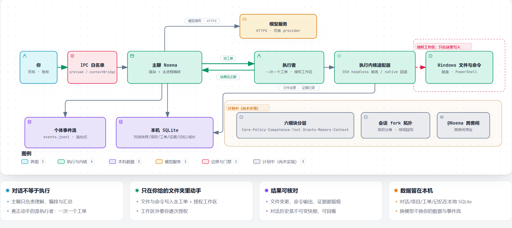

# Noema

一个本地优先的个人 Agent：用户只面对一个 Noema，它理解目标、记住上下文、决定自己回答还是安排执行，并把工作交给可见的执行者完成。不是通用 Agent 框架，也不以聊天功能数量为目标。

当前源码版本、已验证能力和未交付项见 [STATUS](docs/STATUS.md)；V1 能力的排序与进度见 [GitHub Project 看板](https://github.com/orgs/Noema-Harness/projects/1)。

## 它怎么工作



一句话进来，主聊只负责理解、编排和汇总；真正动手的是执行者，它只在项目的文件夹里读写，每一步和每个文件改动都留下可回看的记录。对话、项目与记忆留在本机，换模型不换你的数据。

图中灰色节点与虚线区域「计划中（尚未实现）」标出还没交付的部分（六模块、会话 fork、@Noema 跨房间），其余是当前代码结构。图由 `docs/ARCHITECTURE.md` 生成，`npm run figure:check` 保证它不落后于架构文档。想看可缩放、可切换主题的版本：下载 [noema-architecture.html](docs/assets/noema-architecture.html) 后用浏览器打开（GitHub 不渲染 HTML，只显示源码）。

## 快速开始

环境：Windows 10/11 x64，Node.js 24.21.x（`>=24.21 <25`），npm。

```powershell
npm ci
npm run dev
```

检查：

```powershell
npm run check
```

## 安装

- 便携版：解压 `Noema-win32-x64` 目录后直接运行 `Noema.exe`，不写系统目录。
- 安装包：`Noema-<版本> Setup.exe`。当前未签名，首次安装可能被安全软件（例如 360）拦截写 `%LOCALAPPDATA%`，需要用户放行；不想放行就用便携版。
- 升级、回滚、诊断和发布检查见 [OPERATIONS](docs/OPERATIONS.md)。

## 文档

仓库只保留五份权威文档，加一个入口和一个治理文件。每份文档只回答一类问题；更新触发条件写在文件头和 [AGENTS](AGENTS.md)。

| 文件                                 | 回答的问题                                            |
| ------------------------------------ | ----------------------------------------------------- |
| [PRODUCT](docs/PRODUCT.md)           | 产品是什么、给谁用、用户能观察到什么、怎样算通过      |
| [ARCHITECTURE](docs/ARCHITECTURE.md) | 系统怎样分层、对象和会话怎样组织、数据/代码边界是什么 |
| [DECISIONS](docs/DECISIONS.md)       | 哪些长期选择已经做出、为什么、何时重新审视            |
| [OPERATIONS](docs/OPERATIONS.md)     | 怎样开发、检查、打包、安装、回滚和诊断                |
| [STATUS](docs/STATUS.md)             | 当前版本、已验证/未验证、缺口和已知限制（计划在看板） |
| [AGENTS](AGENTS.md)                  | 一轮开发怎样走、各文档拥有什么、门槛与工程边界    |

README 只做入口，不拥有产品定义、架构、状态或操作细节。

## 目录

```text
apps/desktop/       Electron 主进程、preload、renderer、共享契约
docs/               五份权威文档
openspec/specs/     可观察行为的回归规格
scripts/            仓库级检查与维护脚本
.work/              本机过程材料，不提交
```

用户数据、凭据、下载的参考源码和构建产物不进入仓库。
