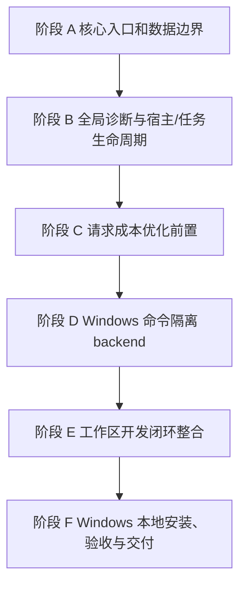

# Noema 一期规划与执行顺序

状态：Gate E 规划交付完成；Noema 一期开发进行中。本文定义范围、验收条件和 20 项分阶段工作。Windows 支持基线已由用户确认：Windows 10 22H2 + 当前 ESU 安全更新；不要求 Windows 11，也不逐 release 维护实现分支。D1 最初以 Codex Windows sandbox 作为候选实现参考；D3 源码审查后，当前实现方向已调整为 Noema 自有的普通 AppContainer runner。Sandy 仅提供 AppContainer 启动原语参考，Codex 继续作为 handle ACL/path、Job 与诊断参考；不直接依赖任一上游 crate。该实现尚未通过目标机 OS 安全验收。本文仍是唯一权威阶段计划；实施时按影响范围创建 OpenSpec change。规划依据：[当前上下文](CURRENT_CONTEXT.md)；完整源码研究与规划契约保存在本机过程目录 `.work/planning/`、`.work/references/`（该目录按工作区约定不纳入 Git）。更新：2026-11-03。

路径约定：研究卡/规划文档里的 `research/...` 相对 `.work/planning/`；源码路径以 `apps/desktop/...` 为仓库根相对路径，简写的 `main/...`、`renderer/...` 相对 `apps/desktop/src/`。

每条外部实现依据引用到一个研究卡；该卡记录固定 `repo@commit`、仓库相对源码位置和适用限制。各源摘要及机器可读版本清单保存在本机过程资料 `.work/references/README.md` 与 `.work/references/revisions.json`。研究卡适用范围比单个 task 广时，以卡中标出的模块边界为准，不把整个项目都算成采纳。

## 一期范围

### 一期要完成的用户闭环

用户在自己的 Windows 电脑上启动 Noema，通过默认界面选择工作区，和 Agent 围绕该工作区完成端到端开发任务：理解代码、制定和调整方案、编辑文件、经明确授权执行受控命令、核验结果并审阅变更。Agent 必须可靠处理任务状态、取消、后台持续运行和失败/重启恢复；窗口关闭后宿主和任务继续运行，用户重新打开能查看进展，并辨明哪些操作完成、未完成或结果未知。真实模型调用前先完成请求上下文与 token/cache 友好性优化。用户可在 Noema 内查到核心任务、错误、模型用量和执行来源，便于日常使用和后续用 Noema 开发自身。

该范围是工程验收闭环，不构成新的差异化定位或终极产品定义。

### 纳入

- Electron Windows 单用户桌面宿主、本地配置/密钥、启动、窗口与托盘生命周期。
- 默认 `SocialChatApp → SocialChatService` 交互；工作区任务由 `SocialWorkService → NoemaProjectExecutor` 持有状态和执行。保留现有主体组织；只为满足此闭环所需的模块边界做重审与加固。
- 工作区选择/身份检查、文件类工具、用户确认、严格隔离的 Windows 命令、任务状态/取消/检查点/副作用结果未知语义。
- 窗口关闭隐藏到托盘；宿主保持运行，当前活动任务不因关窗而中断；显式退出有序收束。崩溃/重启后的行为独立于关窗语义设计。
- 当前核心请求路径的缓存友好性、token 消耗、上下文裁剪、provider usage / 诊断；任何真实模型调用前完成静态请求结构优化检查。
- 应用级调试基础设施及每个核心模块的状态、关联、错误、取消、恢复和本地诊断入口。
- 面向用户这台电脑的可重复 Windows 本地构建/安装/启动/升级或修复/退出/卸载与数据保留检查。不承诺公开发行或自动更新。
- 最终由用户实际使用 Noema 开发验收；助手只承担可有效完成的检查和源码对照。

### 一期不要求

- 学习系统插件的功能设计与实现。保留其未来方向，不影响本体交付。
- 全应用 DSH 式插件化重构、通用插件市场、任意外部 agent runtime marketplace。
- SocialChat 当前复杂的房间、多成员协同、specialist delegation、复杂跟进/实践/经验功能，除非 Gate E 对某项证明它是工作区开发闭环直接必要且已有成熟证据。现存实现、测试、OpenSpec 历史不自动构成一期要求。
- RootAgent + DSH legacy/#legacy 路径与默认 social work 执行路径合并。legacy 实现不作为一期工作区任务的默认 owner；发现其具有唯一必要能力时先补证据再单项判断。
- Windows 一期支持基线为用户确认的 Windows 10 22H2 + 当前 ESU 安全更新。Windows build/UBR gate 只决定严格隔离命令 backend 能否 ready，不是 Noema 桌面程序启动、交互或安装的最低版本要求。AppContainer 与 WFP 所需 API 在 Windows 10 22H2 可用；本实现将当时最新 ESU 累积更新 UBR 7807 作为 command runner 的安全基线，不是 API 兼容线，也未映射到某个特定漏洞。目标机当前 UBR 6093，因此 command runner 仍 fail closed；Noema 桌面/安装生命周期可以在当前系统独立验收。Codex 官方的 Win10 best-effort 声明不构成 Noema 兼容或安全验收。不要求 Win11，不默认自研 VM。若源码审计证明 native runner 无法满足已定隔离边界，再依据具体缺口评估替代路线。
- 云端同步、多机任务接管、任务外部恰好一次语义、公开发行/签名承诺。

## 最终交付条件

每项条件都须由静态/可执行检查或用户本机验收提供证据；“代码存在”“test 通过”或“计划写明”不单独构成通过。

1. 用户能从默认入口选择工作区、开始一个开发任务、理解 Agent 当前阶段与所需权限、查看结果和可检查的差异。
2. 文件/命令工具只按已确认权限工作。Windows 命令经独立隔离 backend；能力探测、策略映射或启动失败时不运行命令、不回退宿主 shell。文件路径别名、无授权工作区外读写/网络访问和进程树必须按目标机威胁边界验收。
3. 关闭窗口后主进程仍在托盘；重新打开可见状态和同一仍运行任务；显式退出、系统关机或进程崩溃有独立且诚实的中断/恢复结果。
4. 任务状态、检查点、外部副作用账本及“结果未知”规则由明确 owner 管理；重试/恢复不盲目重复未定副作用。
5. 所有一期核心功能的诊断可按单次交互贯通到 service、model 请求、工具/child、状态持久化和恢复；包括失败/取消/超时、来源和资源用量。诊断默认本地、脱敏并有限保留；用户导出敏感资料前能看清覆盖范围。
6. 核心真实模型调用之前，完成 provider 请求形状、稳定 prefix、动态上下文、历史裁剪/压缩、tool schema 和 usage 埋点的静态优化检查。真实 cache hit 和成本结果需注明为 provider 报告或未知，后续由实际使用观测，不作无依据承诺。
7. 包装安装到目标机后，升级/修复不丢失用户配置、凭据、会话和任务状态；关闭与卸载行为可理解。外部发布、自动更新不属于本期必需。
8. 助手能按工作项完成源码依据核对和可执行的工程检查；目标机隔离效果、托盘/长任务连续运行、打包安装、模型 cache 实际表现由用户最终验收。用户可用该交付开始 Noema 自身开发，并能在出现问题时查看诊断链。

## 执行顺序

阶段按 A→F 单一顺序推进，保持工作项完成后有唯一下一项。进入 E 前 C3 的首次真实模型调用门槛与 D4 的隔离后端门槛均须满足；任何一项未通过时，工作项保持禁用或停止，不以降低隔离/成本标准继续推进。阶段 A–F 是规划顺序，不意味着发布前要扩展到当前未研究的全部产品功能。

## 工作项通用要求

每个实现工作项开始前创建相应 OpenSpec change，保持跨模块行为契约和迁移说明；小而独立的代码维护遵循仓库现有约定。任何数据库迁移需先盘点当前用户数据/回滚策略，不能覆盖或清理工作区现有资料。

诊断作为每项的必需接口而非收尾附加：每一项均指定 module owner、应用级 execution identity、状态转移、错误/取消/超时/恢复事件、安全脱敏与诊断检索入口。明确助手可以运行的验证和只能由用户实际使用验收的结论；不能通过无依据的长测验收要求拖延。

### 当前测试/验证入口索引

以下为当前可定位的测试文件，阶段任务开始前还要阅读具体断言，不能从文件名推定覆盖已满足；需要的新断言按任务增加。此表不要求在规划期间运行测试，也不将测试通过当作人工/OS验收替代。

| 工作项 | 当前可复核的自动检查入口 |
|---|---|
| A1 | `apps/desktop/test/main/chat/social-chat-service.test.mjs`; `apps/desktop/test/main/execution/social-work-service.test.mjs`; `apps/desktop/test/tooling/social-work-e2e-cli.test.mjs` |
| A2 | `apps/desktop/test/main/chat/social-chat-store.test.mjs`; `apps/desktop/test/main/chat/social-chat-migration-backup.test.mjs`; `apps/desktop/test/main/execution/social-work-service.test.mjs` |
| A3 | `apps/desktop/test/main/ipc/root-ipc.test.mjs`; `apps/desktop/test/main/platform/encrypted-secret-store.test.mjs` |
| B1–B2 | `apps/desktop/test/main/providers/openai-compatible-client.test.mjs`; `apps/desktop/test/main/execution/noema-project-executor.test.mjs`; `apps/desktop/test/main/storage/model-usage-store.test.mjs` |
| B3–B4 | `apps/desktop/test/main/platform/window-geometry.test.mjs`; `apps/desktop/test/main/platform/desktop-notifications.test.mjs`; `apps/desktop/test/main/execution/social-work-service.test.mjs`; `apps/desktop/test/main/chat/social-chat-store.test.mjs`。Tray/Host生命周期需新增专用测试。 |
| C1–C3 | `apps/desktop/test/main/providers/openai-compatible-client.test.mjs`; `apps/desktop/test/main/chat/social-chat-service.test.mjs`; `apps/desktop/test/main/execution/noema-project-executor.test.mjs`; `apps/desktop/test/main/storage/model-usage-store.test.mjs`; `apps/desktop/test/main/platform/encrypted-secret-store.test.mjs` |
| D1–D4 | `apps/desktop/test/main/execution/project-command-sandbox.test.mjs`; `apps/desktop/test/main/execution/noema-project-executor.test.mjs`; `apps/desktop/test/main/platform/runtime-paths.test.mjs`；另需核对 `apps/desktop/forge.config.mts` 与 Windows CI package定义。 |
| E1–E2 | `apps/desktop/test/main/execution/social-work-service.test.mjs`; `apps/desktop/test/main/execution/noema-project-executor.test.mjs`; `apps/desktop/test/main/projects/social-project-store.test.mjs` |
| E3–E4 | `apps/desktop/test/shared/execution/social-work-presentation.test.mjs`; `apps/desktop/test/main/chat/social-chat-service.test.mjs`; `apps/desktop/test/main/chat/social-chat-store.test.mjs`; `apps/desktop/test/main/chat/social-chat-migration-backup.test.mjs` |
| F1 | `apps/desktop/test/main/chat/social-chat-migration-backup.test.mjs`; `apps/desktop/test/main/platform/runtime-paths.test.mjs`；实际干净安装/升级/卸载由 package smoke 与用户目标机验收覆盖。 |
| F2 | 不自动化取代用户的整机/安全/日用验收；助手做计划覆盖、构建包清单、OpenSpec与源码对照。 |

## 阶段 A：收敛默认入口与数据边界

**阶段结果：**一期用户只会进入一条可达的工作区开发路径；工作区任务的状态 owner、核心 API 和需隐藏的入口明确，现有用户数据不被清理或误迁移。此阶段不改变用户可见业务行为以外的结构，具体变更依据仍需 OpenSpec。

**阶段门：**范围为默认路由、project task状态 owner、核心 IPC/敏感数据流；不实现 tray、sandbox 或模型优化。进入条件是 Gate D 范围与 owner 已收敛。接口上 renderer只通过 preload/IPC 消费 SocialChatService/WorkService 能力，SocialChatStore继续拥有一期 project task/checkpoint。每个默认 action可产生 execution identity，诊断覆盖 route、授权与 task创建。检查 IPC/action matrix、迁移边界、source boundary；用户确认安装版只暴露可完成的工作区路径、数据不清除。完成定义是默认工作区路径和 owner 单一且 A1–A3 完成；主要风险是隐藏 legacy入口时错误移除仍依赖的 user data/action。下一阶段 B 在 host 生命周期和诊断基础上进行。

### A1 — 明确一期工作区路径与入口能力表

- **结果/可见行为：**从默认 SocialChatApp 可发现地创建或进入一个工作区任务；一期入口不将 RootAgent/DSH legacy 路径显示为等价的默认项目任务入口。被明确延后的复杂入口有受控的隐藏/不可用状态，不出现可点但未支持的动作。
- **前置：**本计划范围已批准；依据 Gate D D-01 / D-08，`docs/CURRENT_CONTEXT.md`。
- **源码依据：**Noema `apps/desktop/src/renderer/renderer.tsx` 的默认/`#legacy` 路由、`renderer/chat/social-chat-app.tsx`、`main/chat/social-chat-service.mjs`、`main/execution/social-work-service.mjs`、`main/execution/noema-project-executor.mjs`；责任图 `research/noema/CURRENT_MODULE_MAP.md`。参考 Pi `PI_UI_PROTOCOL.md`、DeepSeek Harness `DESKTOP_BACKGROUND_LIFECYCLE.md`、OpenHands `AGENT_SERVER_HOST_PROTOCOL.md`：协议/API入口与实际宿主能力分开。
- **状态/接口：**SocialChatService 管交互；SocialWorkService 管 task 生命周期；NoemaProjectExecutor 管工具 loop/checkpoints；renderer 只消费显式 IPC contract。RootStore/DSH task 不冒充 SocialWork task。
- **异常/恢复：**直接链接 legacy、旧版 saved route、模块未可用时显示明确不可用/迁移结果，不执行不同 owner 的同名续接操作。
- **诊断：**记录 `entry_route_selected`、能力可用性与目标 task ID；默认 route 进入时创建 application execution ID。
- **检查：**静态 route/IPC/action matrix；现有 renderer/IPC 行为测试按仓库约定执行；`npm run source:check`。不做用户数据删除或批量隐藏。
- **用户验收：**从安装版启动后可识别进入工作区任务；延后入口不误导为已具备。
- **完成条件/范围外/下一项：**默认工作区任务路径单一，未纳入功能有显式去向；不重写业务 UI。下一项 A2。

### A2 — 固定核心 task 状态 owner 与迁移边界

- **结果/可见行为：**文档和源码 contract 明确创建、运行、取消、失败、中断、结果未知、恢复、完成各状态的唯一写入 owner；用户从 UI 看到的状态与持久记录一致。
- **前置：**A1 完成；无未经盘点的数据清理。
- **源码依据：**`social-work-service.mjs::startTask/resumeTask`、`noema-project-executor.mjs::startTask/checkpoint`、`chat/social-chat-store.mjs` 的 task/checkpoint/execution-step 持久化和 migration；Noema `CURRENT_STATE_RUNTIME.md`。参考 DSH Prototype `DURABLE_EFFECTS_OUTBOX.md`、Pi Durable `PI_DURABLE_SCOPE.md`、OpenHands `PERSISTENCE_RECOVERY.md`：durable task、外部副作用和活动进程恢复不可混同。
- **状态/接口：**SocialChatStore 继续作为一期 project task/checkpoint/execution-step 权威 owner；Service 做合法状态转换和授权；Executor 以检查点事件回报。不把 `RootStore.background_tasks` / DSH Session 当同一任务库；若研究中发现职责重复，先迁移提案再实施。
- **异常/恢复：**副作用后进程中断时保留 `outcome_unknown`，恢复资格由可检查点和原 workspace identity 决定；不自动重复未知执行步骤。
- **诊断：**任务状态每次转换带 execution ID、task ID、前后状态、原因、检查点位置、tool action类别和错误类别，不保存秘密/完整文件正文。
- **检查：**读 schema/migration、事务边界、有效 transition 和既有 tests；增加状态转换与 migration tests；可执行 repository schema/source checks。无大规模故障长测。
- **用户验收：**在日常使用中停止/失败后看到“可恢复 / 需重做 / 结果未知”的准确区别；用户确认工作区内已有任务和数据未被误删。
- **完成条件/范围外/下一项：**所有 task mutation 有单一 owner 与状态契约，历史不确定副作用保留；不把跨用户/云端续接纳入。下一项 A3。

### A3 — 明确一期 IPC 权限和敏感数据流

- **结果/可见行为：**工作区选择、授权、task start/stop/resume、diagnostics export 每个 renderer action 都有明确可信 sender、授权来源和敏感字段名单；无窗口时需要用户授权的动作安全拒绝并可诊断。
- **前置：**A1–A2。
- **源码依据：**`main/ipc/root-ipc.mjs` sender wrapper、`main/preload.ts` contextBridge、`main/main.ts` workspace dialogs、`main/encrypted-secret-store.mjs`；`CURRENT_STATE_RUNTIME.md` 对 renderer-health/usage export 的隐私观察。参考 Goose `CREDENTIALS_CONFIGURATION.md`、OpenHands `AGENT_SERVER_HOST_PROTOCOL.md` 和 `DIAGNOSTICS_OBSERVABILITY.md`。
- **状态/接口：**主进程拥有文件对话框、秘密与权限；renderer 只持有必要的 scoped grant/result；diagnostics export 明确 scope。
- **异常/恢复：**sender 不可信、mainWindow 不存在、grant 过期、路径身份变化均拒绝并说明具体原因；不复用过期授权。
- **诊断：**审计 authorization requested/granted/denied/revoked，不记录 secret 内容；诊断导出前提供文件、消息、workspace path、prompt 等覆盖提示。
- **检查：**IPC capability map 对照 preload 暴露面与 main handlers；现有 IPC tests + 不可信 sender/无窗口拒绝用例；隐私字段静态审阅。
- **用户验收：**无窗口/窗口隐藏时，要求人类确认的操作能唤回窗口或拒绝，不会静默扩大权限；导出内容范围明确。
- **完成条件/范围外/下一项：**核心 IPC 权限/数据流矩阵覆盖所有默认入口动作；不做遥测上报。下一项 B1。

## 阶段 B：全局诊断与宿主/任务生命周期

**阶段结果：**Noema 在窗口与应用进程生命周期分离后保持可操作；每个核心执行有跨模块 identity 和可查询的本地状态，正常隐藏窗口不会引发服务关闭。

**阶段门：**范围为 application trace contract、本地只读诊断、Tray/window/Host分离、project task在host关闭时的协调；不开放真实模型调用，也不实现command backend。进入条件是A阶段 owner/IPC完成。状态由Host、SocialWorkService/Executor、SocialChatStore各按职责拥有，通过ID/事件关联；renderer只订阅/查询。诊断覆盖其自身存储/查询故障；可执行检查含事件关联、敏感导出、关窗/退出/单实例测试。用户在Windows通知区确认 hide/restore/exit 和关窗后task持续。完成定义是窗口关闭不触发 shutdown，退出/崩溃结果可识别，诊断事件可查；主要风险为SQLite/服务后台生命周期与老事件缺少关联。下一阶段C基于稳定execution identity梳理模型调用。

### B1 — 建立应用级执行关联和本地事件规范

- **结果/可见行为：**一次用户操作有稳定 execution ID；chat turn、task、provider request、tool call/child process、存储写入和恢复都能关联或明确标记不适用。诊断查询能按 execution/task 时间线找见事件。
- **前置：**A1–A3 状态/IPC边界明确。
- **源码依据：**Noema `SocialChatService` operation/interaction ID、`SocialWorkService` task ID、`NoemaProjectExecutor` tool-call/checkpoint、Provider usage callback、`ModelUsageStore`；`CURRENT_STATE_RUNTIME.md` 指出现有 ID 不等价。参考 Pi `PI_TELEMETRY_DISTRIBUTION.md`、Goose `DIAGNOSTICS_DEBUGGING.md`、Letta `DIAGNOSTICS_TELEMETRY.md`、OpenHands `DIAGNOSTICS_OBSERVABILITY.md`。
- **状态/接口：**选定一个受版本控制的 event contract 和稳定关联规则；优先复用既有共享 SQLite 装配但由独立诊断 owner 管迁移/查询；应用重启不重用 execution ID；调用方必须提供 parent ID 或明确起新根。
- **异常/恢复：**诊断写入失败不静默影响正常 Agent 工作；设容量上限、错误计数和诊断自身故障告警；数据库事务和执行副作用不能因为诊断事件写入失败而含混。
- **诊断：**事件包含时间、模块、operation、状态/错误代码、parent/child ID、脱敏字段；正文/prompt/token secret 默认不存。
- **检查：**事件 schema 版本和 ID 传递静态检查；关联模型请求/工具失败/任务恢复的单元测试；存储迁移与保留上限测试。不生成真实模型请求。
- **用户验收：**本地诊断视图可从一次任务定位到模型、工具和恢复事件；事件链无法覆盖处要显式显示断点。
- **完成条件/范围外/下一项：**新核心路径统一传 ID 和事件；旧/非核心路径单独标成非覆盖，不伪装全覆盖。下一项 B2。

### B2 — 提供本地诊断检索与安全导出

- **结果/可见行为：**用户能在 Noema 内查看最近运行的 task/turn、状态、错误、取消/恢复、模型 usage 和 child 结果，并按 task/execution 过滤；用户主动导出可读报告。
- **前置：**B1；A3 的权限和敏感数据清单。
- **源码依据：**现有 `diagnostics:model-usage` CLI、`renderer-health.jsonl`、SocialWork execution steps、ModelUsageStore；MXC `DIAGNOSTICS_PRIVACY.md`、OpenHands diagnostics card、Goose diagnostics card。
- **状态/接口：**诊断 UI 只读调用统一 DiagnosticsQuery API；本地事件/usage/task 状态各由其现有 owner 写入，查询层不复制正文；导出使用版本化 manifest。
- **异常/恢复：**过期/缺损日志可展示缺口；数据库不可用时不会妨碍窗口关闭/退出；导出写入失败不丢在线记录。
- **诊断：**诊断组件也用 execution ID 标记自身查询/export/错误，限制事件保留和磁盘空间；导出前显示包含路径、prompt、消息、错误正文等敏感范围。
- **检查：**敏感字段 allowlist/redaction tests、保留/轮转/损坏记录测试、export schema tests；对照旧 CLI 导出确保没有悄悄加入密钥。
- **用户验收：**用户能定位一次 token 异常或任务失败并将报告保存在本机；默认没有外发/自动上传。
- **完成条件/范围外/下一项：**核心运行可查、导出主动、敏感 scope 清楚；不做远程 telemetry dashboard。下一项 B3。

### B3 — 将窗口关闭与应用退出分离并实现托盘

- **结果/可见行为：**关闭主窗口只隐藏窗口并显示系统托盘；从托盘恢复同一窗口/会话；显式退出才触发宿主 shutdown；单实例第二次启动聚焦/恢复窗口。
- **前置：**B1–B2 的启动/错误诊断入口；A2 task 状态 contract。
- **源码依据：**`apps/desktop/src/main/main.ts` 的 `window-all-closed`、`before-quit`、single-instance 和 BrowserWindow 创建；`CURRENT_STATE_RUNTIME.md`；参考 DeepSeek Harness `DESKTOP_BACKGROUND_LIFECYCLE.md`、Goose `DESKTOP_BACKGROUND_LIFECYCLE.md`。
- **状态/接口：**Electron Host 拥有 `Tray` 和 mainWindow lifecycle；close/hide 与 app quit 分开；Tray menu 事件经 host owner 执行。Tray renderer 退出不可作为唯一 task 状态 owner。
- **异常/恢复：**Tray/icon 初始化失败有明确策略和本地诊断；创建窗口失败不重复创建 services；显式退出以有界时间等任务 stop/child cleanup，超过 deadline 标记 interrupted/outcome_unknown 后关闭。
- **诊断：**`window_hidden/restored`、`tray_ready/error`、`exit_requested/shutdown_started/completed/timeout` 与任务 ID 关联；Windows 通知区 icon 丢失可从 app 内重新显示。
- **检查：**Electron host lifecycle unit/integration checks、single-instance/close-to-hide/explicit-exit/Tray creation errors；Windows packaged smoke test。此项需对 Windows notification area 做用户目视验收。
- **用户验收：**窗口关闭后托盘可见，关窗期间任务继续；托盘恢复显示原状态；显式 Exit 与 close window 区别明确。
- **完成条件/范围外/下一项：**Windows 上关闭窗口不触发 app quit，显式退出确实执行 shutdown；不自动配置登录启动。下一项 B4。

### B4 — 为 project work 建立与窗口独立的运行/退出协调

- **结果/可见行为：**窗口隐藏、重建或刷新不丢失活动 task 的状态订阅；关闭窗口期间 service/child 继续；显式退出、系统关机和应用崩溃各自给出不同的状态与可恢复性。
- **前置：**B3、A2。
- **源码依据：**`main/chat/social-work-service.mjs` active-task/shutdown/resume、`main/execution/noema-project-executor.mjs` abort/checkpoint、`chat/social-chat-store.mjs` interrupted task recovery；参考 Pi Durable `PI_DURABLE_SCOPE.md`、DSH Prototype `DURABLE_EFFECTS_OUTBOX.md`。
- **状态/接口：**Host 长于 BrowserWindow；SocialWorkService/Executor 生命周期隶属于 Host；renderer 使用订阅/re-query API，不拥有活任务；task store 有权威状态。关闭主窗口不会调用 service shutdown。
- **异常/恢复：**显式退出触发 graceful cancel/drain，再按 checkpoint 策略关闭；崩溃恢复不重放 outcome_unknown side effect；关机信号遵照同一 stop deadline。
- **诊断：**记录 host lifetime、task lifetime、窗口订阅 attach/detach 分离；每任务保留启动时间、heartbeat/progress、stop原因、退出结果和最后安全 checkpoint。
- **检查：**service 不依赖 BrowserWindow 存活的调用图审查；renderer detach/reattach 和 shutdown signal tests；checkpoint failure injection tests 在可控模块内执行。不做多小时耐久长测。
- **用户验收：**用户可关窗并稍后回来查看仍在跑的工作；明确退出后知道任务是已停止、checkpoint 可续或存在未知副作用。
- **完成条件/范围外/下一项：**关窗不触发 cancel，host shutdown 按契约标记任务；不承诺掉电时模型/子进程原位续跑。下一项 C1 与 C2 可按依赖顺序开始。

## 阶段 C：首次真实模型调用前的请求与 token 优化

**阶段结果：**一期实际启用的模型调用路径都完成静态 request review 和可证明的 token 减少；provider usage 缺字段保留 unknown。真实 provider 调用在 C2 完成之前明确禁止。

**阶段门：**范围仅限最终一期 chat/work请求和usage，不对隐藏入口优化；不需要真实API请求。进入条件为B阶段 execution correlation 和diagnostic data contract可用。SocialChatService/Executor拥有上下文语义，Provider负责协议/usage，关联ID跨越调用；诊断记录模板版本、裁剪、估算和provider-reported usage。检查为payload fixture/tokenizer边界/usage parsing/redaction；用户在首次真实请求前看优化对照，之后使用上游真实usage。完成定义是C1–C3全过且首调gate自动解除；风险是provider API变化及模型tokenizer不可可靠静态估计。下一阶段D把command加入同一task执行诊断链。

### C1 — 确认一期模型请求路径及稳定/动态输入边界

- **结果/可见行为：**只保留默认 chat、project executor 和用户确认必需的 followup 等请求；每条路径有 payload 顺序图，说明 system/developer prompt、tool schema、history、workspace snapshot、动态 state、结果裁剪及重复段。
- **前置：**A1/D-01 核心入口和 A2 状态 owner。
- **源码依据：**Noema `social-chat-service.mjs` request builders、`noema-project-executor.mjs` prompt/context/compaction、`openai-compatible-client.mjs` payload/usage、`model-usage-store.mjs`；`CURRENT_STATE_RUNTIME.md` request comparison。
- **参考：**Pi `PI_AI.md`、DeepSeek Harness `AGENT_LOOP_MODEL_REQUEST.md`、Goose `AGENT_PROVIDER_LOOP.md`、Letta `PROVIDER_PAYLOAD_CACHE.md`。
- **状态/接口：**每个 provider request 关联 chat turn/task ID + execution/span；主 transport 负责协议/usage，不擅自决定 harness context。
- **异常/恢复：**usage 缺失/缓存统计不一致记录 unknown；超 context limit 有有界裁剪策略和用户可见失败，不能 silently drop 最新有效指令。
- **诊断：**记录 provider/model、请求模板版本、message/tool count、字符估算、usage 原字段和裁剪/compaction 原因，不持久保存完整 payload 默认值。
- **检查：**无网络 payload fixture/snapshot 对照和上下文裁剪边界测试；静态确认每种启用 provider 的字段；不调用真实模型。
- **用户验收：**给出的请求摘要可让用户辨认哪些 workspace/context 内容会进入模型；真实内容披露边界明确。
- **完成条件/下一项：**一期启用请求路径全量列出，不再因 legacy endpoint 默认启用隐藏请求。下一项 C2。

### C2 — 优化稳定 prefix、工具定义与 token/context 裁剪

- **结果/可见行为：**不改变用户可见授权/事实语义的前提下，稳定可缓存 prefix、把易变内容靠后、减少可证明的重复上下文，并按已确认模型的 tokenizer/context window 设限；未知时保持明确保守界。OpenAI-compatible 请求每轮仍发送完整 tools schema；仅在对象构造层复用常量不算 token 节省，不得省略受授权或状态影响的工具定义。
- **前置：**C1；不需要真实 API key 调用。
- **源码依据：**同 C1；参考 Pi AI provider cache、Goose provider-specific cache hints、Letta 锁定 pi-ai request payload。
- **状态/接口：**harness owner 组织语义，provider adapter 仅编码有官方依据的 cache 参数；tokenizer 选择必须绑定明确 provider/model/version，不假设字符数等于 token，也不把 DeepSeek-specific encoding 推广到 generic endpoint。
- **异常/恢复：**达到预算时分层裁剪可重建摘要/旧工具回执，不裁掉最新 user instruction、权限或未完成副作用状态；压缩失败可回退到保守拒绝并给出原因。
- **诊断：**每个裁剪/压缩决定记录被保留/删除的类别和可用 tokenizer 估算，避免记录原文；provider cache hit 缺失时展示 unknown，不显示为 0。provider 请求形状另按固定消息 role 汇总 message object JSON 字符数，帮助定位 system/developer/user/assistant/tool/other 哪类体量增长；该计数不是 token，旧记录缺失时显示 unknown，导出默认排除。
- **检查：**请求 prefix 稳定性、可用的模型边界 token count、完整 tool-schema 语义/序列化、compaction 保留关键状态的测试；静态比较优化前后 payload 字符形状与可证明的 model-specific token estimates。不运行长测。
- **用户验收：**真实模型调用前检查记录完整；用户确认内容语义与现有工作指令不被裁剪。
- **完成条件/下一项：**所有必要 request path 经过优化审查，输出优化差异；仍未知的 provider 行为被明列。下一项 C3。

### C3 — 校验真实调用前门槛及用量记录

- **结果/可见行为：**真实模型调用有明确 gate；只有 C1/C2 的请求模板、context limits、secret handling、diagnostics、usage fields 被审阅并签收后才可通过现有凭据调用。用户已经授权真实模型预算，不额外增加确认步骤。
- **前置：**C1、C2、A3、B1、B2。
- **源码依据：**`openai-compatible-client.mjs`、模型 credentials getter、ModelUsageStore；参考 Pi/Goose provider usage 卡。
- **状态/接口：**每个 request 带执行关联 ID；usage 保存 provider 原报告并区分 input/output/cached/miss/cost unknown。
- **异常/恢复：**provider 返回拒绝/超时/断线时 usage 记录 request outcome 与未知 token 字段，不重试非幂等工具；key 缺失/失效不回显。
- **诊断：**请求生命周期事件含开始/首 token/完成/中断/usage missing；敏感 prompt 不进入常规日志。
- **检查：**mock/provider fixture 的 usage parsing、key redaction、request gate 和中断路径测试；不发生真实调用，直到用户使用/验收授权的首次调用门槛满足。
- **用户验收：**首次真实模型调用前查看静态优化清单；门槛通过后使用既有凭据进行真实请求；调用后在 Noema 本地诊断中辨认上游报告和 unknown 值。
- **完成条件/下一项：**静态门槛逐项满足后解除调用 gate 并使用现有凭据；不宣称真实 cache hit 成功率。下一项 D1。

## 阶段 D：Windows 命令隔离与进程生命周期

**阶段结果：**提供满足目标机能力边界的 OS 隔离命令路径；不支持设备上命令工具隐藏或明确禁用，绝不宿主回退。若 Windows runner 源码/目标机验收未能证明所需隔离，Noema 不能宣称一期工程闭环通过。

**阶段门：**范围为 Windows native runner、用户确定的单一支持基线（Win10 22H2 + 当前 ESU 更新）、启动能力检查、workspace/file/network policy、child、后台任务和安装/更新。不逐 release 分叉，不要求 Win11，不默认自研 VM。D1 已选定 Codex-source-derived Noema bridge/维护子集，但 D3 token/bootstrap 源码审查发现该受限令牌路径与已确认的 hard-link 边界冲突；按用户先前授权的无回复默认规则，2026-11-03 暂将普通 AppContainer 作为新执行身份方向，使用 Sandy 的 AppContainer 启动原语作补充源码参考，Codex 继续作为 handle ACL/path/Job/诊断参考。该决策不代表功能或 OS enforcement 已验证。D2–D4 负责逐项策略实现、WFP hard-fail、进程生命周期、依赖/许可、打包与目标机验收。Noema 拥有授权决策/任务结果；backend 拥有策略编译、隔离进程和本机进程通信。诊断关联 policy→probe→setup→spawn→child→cancel/cleanup/recovery。助手核验源码、结构与可复核检查；用户验收目标机 OS enforcement 与长期日用。ESU/系统/API/setup/policy 能力缺失时命令拒绝执行；任何 backend 能力缺失都无宿主 fallback，命令关闭不算一期闭环通过。下一阶段 E 才将 command 加入工作区 Agent。

### D1 — 选定兼容目标机的严格隔离后端

- **结果/可见行为：**依据固定源码评估确定 Noema 自有 Windows runner 的 backend contract、用户确定的单一最低 Windows 基线（Win10 22H2 + 当前 ESU 更新）、启动 API/setup/policy capability probe、依赖/许可/SBOM 和目标机验收边界。最初候选 Codex restricted-token 路径因无法满足已确认的 hard-link 边界而被放弃；当前实现方向为普通 AppContainer。Sandy 仅作 AppContainer 启动原语参考，Codex 作 handle ACL/path、Job 与诊断参考；不直接依赖上游 crate API或引入 Codex app/workspace。WFP setup 必须 fail closed。不为每个 release 做单独适配。Codex 官方 Win10 best-effort 声明仅作支持范围参考，不是 Noema 兼容或安全结论。
- **前置：**Codex 固定 SHA 源码卡和 Windows 隔离候选审计；当前目标机已核实为 Windows 10 22H2/build 19045、UBR 6093。闭合 permission→setup→policy→runner→cleanup 调用链并核对 crate 依赖、许可证和可重复构建路径后，按既定威胁边界判断策略可表达能力、拒绝行为与可集成性。
- **源码依据：**`research/noema/CODEX_WINDOWS_SANDBOX.md`、`research/noema/WINDOWS_ISOLATION_CANDIDATE_COMPARISON.md`、`research/noema/WINDOWS10_ISOLATION_CANDIDATES.md`、`research/noema/SANDY_SOURCE_REVIEW.md`；Codex 固定源码中的 `setup.rs`、`elevated_impl.rs`、`process.rs`、ACL/reparse/WFP/identity/diagnostic 模块；Noema 本地 SRT provenance README/patch。MXC/PSEC `INVENTORY.md` 与 request/capability 卡作为备选路线参考，不构成 Win10 前置。
- **状态/接口：**backend contract 抽象 capabilities/reasons/version/backend identity，不向 Agent 伪造支持状态；D1 当前基线为 Noema 自有 AppContainer runner，D2 逐项确定 policy mapper 与 runtime adapter 接口。
- **异常/恢复：**原生库/ABI/系统 build/capability 不符时启动拒绝命令功能；由于命令是完整开发闭环的必要能力，这种状态属于一期交付阻断，不能将“仍可对话/文件操作”视为一期完成；不装入未经研究的 helper 后尝试。
- **诊断：**启动 probe 记录 OS build/架构、API availability、支持 capability 和拒绝理由；不搜集账号凭据或私人路径。
- **检查：**逐项核实输入/输出、文件/网络策略、后台生命周期、取消/恢复、管理员 setup 门槛和 fail-closed 行为；标清固定源码能证明与不能证明的内容。核对 `apps/desktop/package.json`、root `package-lock.json`、`apps/desktop/forge.config.mts` 和 Windows CI workflow；依赖/license/SBOM 与原生 build/package 可重复性列为开发阶段检查。不触发真实受限命令。
- **用户验收：**最终在目标机查看 OS/API/setup 能力报告并验收实际 enforcement；若设备 capability/setup 不足，Noema 拒绝命令并清楚说明原因，不要求为单一 feature 立刻升级或降级隔离标准。
- **完成条件/下一项：**固定源码调用链与依赖边界审阅完成；形成 backend contract、单一 OS/update 基线、能力 probe 与拒绝理由、逐策略映射工作入口、WFP hard-failure 要求、SBOM/许可/build/package 任务和目标机验收表；风险与 fail-closed 行为均可追踪。通过后下一项 D2。

### D2 — 将 Agent workspace grant 编译成受限执行策略

- **结果/可见行为：**模型只能请求结构化 command intent；Noema 主进程校验已选 workspace、单次用户 grant、网络/文件权限与 backend 每条 policy capability，再生成具体 backend 请求；UI 展示 workspace 外 read/write/network 具体对象。
- **前置：**D1；A3 权限；B1 event identity。
- **源码依据：**`noema-project-executor.mjs` 的 `run_command` schema/authorization、`project-command-sandbox.mjs` 当前 path/network grant 与 Windows gate；Codex `CODEX_WINDOWS_SANDBOX.md` 的 permission profile/ACL/WFP 模块；MXC `FILESYSTEM_PATH_POLICY.md`、`NETWORK_UI_POLICY.md` 作为对照。
- **状态/接口：**Noema owner 用户 intent/grant 生命周期；backend owner OS policy serialization；不将字符串 allowlist 当 canonical path/identity 安全证明；Noema task记录授权来源与backend result。
- **异常/恢复：**路径解析改变/reparse/hardlink/canonical identity 无法判断、任一获读/写 capability ACL 的根内普通文件 NTFS link count 大于 1、未知 network target、backend不能证明完整表达策略或网络拒绝 setup 失败、授权 UI 不可用，全部拒绝并给出可操作原因；command 不 spawn。
- **诊断：**policy 编译输入/结果携带 request identity 与稳定安全原因码，mapper 不输出路径、域名、命令或环境值。真实 grant ID 与 backend rejection phase 由 D3 runner 接入本机 event store 后生成和关联；不在没有 runtime owner 时伪造执行阶段事件。
- **检查：**policy mapper tests、恶意路径和 capability mismatch tests、host window absent deny tests；静态检查请求字段与固定 backend contract；OS效果仅用户验收。
- **用户验收：**核对 workspace 内外访问授权提示、撤销及目标机拒绝行为；确认默认出站网络边界符合用户要求。
- **完成条件/下一项：**每个模型意图到OS策略字段可追溯、不可表达策略总是拒绝；无 host fallback。下一项 D3。

### D3 — 实现 suspended launch、命令IO、取消与进程树收束

- **结果/可见行为：**命令在隔离生效与 Job/进程生命周期控制成功后才开始运行；用户可看到 stdout/stderr、退出状态和耗时；停止/超时可终止整棵子进程树。
- **前置：**D1–D2；B4 task shutdown contract。
- **源码依据：**Noema-owned `SECURITY_CAPABILITIES`/`CreateProcessW` AppContainer launch direction；Sandy `Sandbox.h`、`SandboxCapabilities.h`、`SandboxProcess.h` 的 AppContainer capability/process-attribute 启动原语；Microsoft AppContainer docs；Codex `CODEX_WINDOWS_SANDBOX.md` 的 handle-based ACL/path、Job/pipe/cancel/diagnostics 调用链；MXC `PSEC_CAPABILITY_AND_LAUNCH.md`、`PROCESS_IO_LIFECYCLE.md` 作对照；Noema `project-command-sandbox.mjs` 与 `NoemaProjectExecutor` lifecycle。
- **状态/接口：**backend adapter 持有 native handle/child/job/pipes；executor 持有 tool call ledger；SocialChatStore 持有可恢复 task facts。console流只由 executor 追加为受限结果。
- **异常/恢复：**AppContainer profile/capability setup、process create、Job bind、pipe、cancel、timeout 任一步失败都不得留下未受限 child；任务恢复若执行结果不明记 outcome_unknown，不自动第二次执行。
- **诊断：**每条命令记录 backend id、spawn phase、PID关联（仅本地）、stdout/stderr截断统计、deadline、终止原因、exit code 与清理结果；截断保留边界可见。
- **检查：**child lifecycle/cancel/timeout/IO backpressure/cleanup 单元和可控进程集成测试；隔离恶意访问由目标机验收做，助手不伪造 OS enforcement 效果。
- **用户验收：**运行安全无害本地任务、主动停止、多进程任务与超时；确认子进程已收束，工作区外/未授权网络尝试拒绝。
- **完成条件/下一项：**返回状态/退出原因可确定，取消后无残留进程，任何设置失败无 untrusted spawn。下一项 D4。

### D4 — 统一命令能力 UI、Windows 打包资源与安全回归门

- **结果/可见行为：**Noema 按运行时能力显示 command 可用/不可用与拒绝原因；移除仍展示但执行前必然拒绝的旧 SRT helper 安装承诺；package 仅包含一个实际使用 backend/版本。
- **前置：**D1–D3。
- **源码依据：**`main.ts` workspace picker SRT installer、`project-command-sandbox.mjs` helper override/support gate、`forge.config.mts` extraResource；`WINDOWS_ISOLATION_CANDIDATE_COMPARISON.md`。
- **状态/接口：**main process capability report 作为 UI 单一来源；renderer不从文件存在与否自行推断支持。
- **异常/恢复：**更新/修复缺失原生资源不降级；启动后 probe 变更就禁用新命令并说明正在运行的任务如何收尾。
- **诊断：**backend package/runtime version、probe delta、resource load、用户可见 capability 展示共用 execution identity。
- **检查：**Forge package contents manifest、clean-user install/uninstall/upgrade/repair smoke、错误注入缺失/版本冲突；不执行安全验证之外的真实项目命令。
- **用户验收：**安装版显示的支持状态与真实 target capabilities 一致；升级后旧 SRT 提示消失、Noema用户数据保留。
- **完成条件/下一项：**只有一个可审计backend来源，UI/包/执行同源；若隔离 target-machine gate失败则命令维持禁用、一期交付条件未满足，不回退宿主 shell。下一项 E1。

## 阶段 E：工作区开发闭环整合

**阶段结果：**默认入口中的对话、文件理解/变更、隔离命令、task status、结果和诊断完整连接到同一任务 owner；非核心社交路线不干扰日常开发闭环。

**阶段门：**范围为workspace identity、批准的文件/command actions、task projection及安全恢复；不合并RootAgent/DSH、不带入复杂房间/协作/学习系统。进入条件为A–D完成，真实模型gate及Windows隔离gate通过；若command gate失败，可继续修复其他部分，但不能宣称最终闭环通过。SocialWorkService/NoemaProjectExecutor/SocialChatStore各负其责，renderer只投影；诊断贯穿conversation/task/action/checkpoint。执行静态/source、受控小型自动检查和用户真实工作区验收；用户确认diff/停止/恢复/副作用未知行为。完成定义为E1–E4闭环且无隐藏的状态分叉；风险是并行编辑、路径授权与旧checkpoint compatibility。下一阶段F做包装和整体验收。

### E1 — 工作区身份、项目任务与会话上下文

- **结果/可见行为：**开始任务时绑定规范化 workspace identity 和明确项目目标；切换目录或路径身份变化会要求用户重新确认；session/turn/task与workspace关联可查看。
- **前置：**阶段A；B1; D2 策略 grant。
- **源码依据：**`social-work-service.mjs` workspace validation/resume、`noema-project-executor.mjs` context、`social-chat-store.mjs` task/membership schema；参考 OpenHands `PERSISTENCE_RECOVERY.md`、DSH `EXECUTOR_SESSION_WORKSPACE.md`。
- **状态/接口：**SocialProjectStore拥有workspace/project元数据，SocialChatStore拥task/checkpoint；不得把已选择目录路径信任为长期授权本身。
- **异常/恢复：**workspace missing/renamed/reparse identity changed 时暂停并要求用户重新选，不让Agent套用旧grant。
- **诊断：**task/workspace identity变更、manifest读取、context snapshot摘要与用户grant关联，默认不写文件内容。
- **检查：**path identity/rename/remount/missing workspace测试与resume admission测试。
- **用户验收：**选择自己的Noema工作区开始一次独立任务，错误选择/移动目录时得到安全拒绝。
- **完成条件/下一项：**任务绑定workspace identity，不再仅用展示路径；下一项 E2。

### E2 — 文件工具和变更结果可核验

- **结果/可见行为：**获得工作区任务授权后，Agent 的成功文件写入立即应用到工作区；任务结束后提供逐文件差异，用户可审阅并选择保留或安全撤回；错误写入可按版本控制/恢复方案回退。
- **前置：**E1、A3/D2 path authorization。
- **源码依据：**Noema `NoemaProjectExecutor` file tools/ledger、SocialWork execution step；Pi `PI_TOOLS.md`、OpenHands `TOOL_SECURITY_WORKSPACE.md`、Letta `TOOL_EXECUTION_SECURITY.md` 作为不同权限反例。
- **状态/接口：**工具owner和文件写入owner明确；在支持版本控制时使用workspace git diff作为用户核对依据但不擅自git reset/clean；未跟踪文件单独列出。
- **异常/恢复：**部分写入/用户同时改动/工具失败时报告已落盘范围，不声称事务回滚；避免无用户批准覆盖未读内容。
- **诊断：**记录文件操作类别、相对path、前置hash/结果hash（适用时）、结果与恢复提示；不把整个源码放进日志。
- **检查：**路径逃逸、并发修改、部分写失败、diff映射的测试；文件数据保全检查。
- **用户验收：**授权一项工作区任务并确认成功写入在任务运行期间立即落盘；任务结束后逐文件审阅并选择保留或撤回；若文件之后被用户或其他程序修改，撤回必须拒绝覆盖。
- **完成条件/下一项：**所有写动作有授权、结果/失败可见、变更能审阅；不实现自动Git commit/push。下一项 E3。

### E3 — 工具计划、模型交互与任务 UI 对齐

- **结果/可见行为：**用户能区分模型思考/文本答复、待用户授权工具、正在执行的工具、后台等待、成功、失败、中断和结果未知；不会把“工具已请求”展示成“执行成功”。
- **前置：**B1–B4、C3用户首调用门槛、E1–E2、D3。
- **源码依据：**`renderer/chat/messages.tsx` 当前task state/actions、SocialWorkService event emitter、NoemaProjectExecutor tool call/result/checkpoint、OpenHands `AGENT_SERVER_HOST_PROTOCOL.md` 与 DeepSeek Harness `AGENT_LOOP_MODEL_REQUEST.md`。
- **状态/接口：**SocialWorkService权威用户可见任务状态，Executor权威当前 tool call；renderer仅投影；task/thread/turn ID映射明确。
- **异常/恢复：**double click/inflight重复授权幂等；disconnect/tool timeout/renderer reload时可重新查询DB；消息失败不抹掉真实执行记录。
- **诊断：**用户UI状态与后台事件由同一state transition source生成；trace缺失/渲染错误显示局部，不生成虚构事件。
- **检查：**event ordering、duplicate submit、renderer reload、stale IPC、tool result missing等测试与UI状态快照检查。
- **用户验收：**完成一次包含读取/修改/授权命令的任务，可在UI看见每一步真实状态与结果。
- **完成条件/下一项：**所有核心状态映射有UI并可从诊断回查；不扩复杂群聊界面。下一项 E4。

### E4 — 失败恢复、停止/续接和部分结果交付

- **结果/可见行为：**用户可在当前进程停止、在安全 checkpoint 继续、或在 side effect 不确定时从头分析而不盲重跑；Agent 能交付部分成果和明确待办。
- **前置：**A2、B4、E1–E3、D3。
- **源码依据：**`SocialWorkService.resumeTask`、executor checkpoint/call ledger、SocialChatStore restart recovery/outcome_unknown；参考 DSH `DURABLE_EFFECTS_OUTBOX.md`、Pi Durable、OpenHands `PERSISTENCE_RECOVERY.md`。
- **状态/接口：**任务恢复 admission 在service owner；Executor只接受模型边界/完整工具批次等安全checkpoint；resume会验证model/workspace/grant/session条件。
- **异常/恢复：**恢复条件变化/检查点版本不兼容/外部命令副作用未知时禁止自动续接，提供清晰检查清单；重试创造新attempt并保留前序结果。
- **诊断：**记录原task ID、新attempt ID、checkpoint、不可恢复原因、outcome_unknown副作用、用户选择。
- **检查：**各state恢复门、不可重复副作用、schema升级/旧checkpoint拒绝 tests；数据库损坏/中断按可执行模拟验证。
- **用户验收：**主动停止、重启/异常中断恢复和一个安全工具任务结果确认；确认不会静默重复修改。
- **完成条件/下一项：**每种持久状态都有明确恢复/拒绝规则和 UI；不声称原进程续跑或exactly-once。下一项 F1。

## 阶段 F：本地安装、目标机核验与交付

**阶段结果：**用户能从可重复 Windows package 安装/修复 Noema，正常启动/退出并保留自身配置和状态；进行受控最终验收，未通过项明确保留为阻断，不以研究文档替代可用软件。

**阶段门：**范围为用户现有电脑的本地package、升级/修复/退出/卸载和完整开发闭环验收；不公开发行、不承诺auto-update或签名、不启动学习系统项目。进入条件为A–E的行为和状态合同完成，且 Windows 隔离方案满足目标机；Windows 命令仍关闭时不得通过 F2，不得宣称一期完整交付。Forge负责package/native resources，DB store负责迁移/保全，用户拥有最终验收；诊断由版本/迁移/启动连至task trace。检查package/migration/install smoke；用户执行端到端开发任务、开窗关窗、真实模型请求、workspace更改、安全命令、恢复和diagnostics验收。完成定义为F1候选安装与数据保全通过且F2用户确认可用 Noema 完成开发任务；风险是目标机/签名/原生依赖更新差异。后续入口为用户在Noema中创建第一项自主开发任务，而不是自动扩大一期范围。

### F1 — 可重复 Windows package、安装升级与数据保全

- **结果/可见行为：**从固定源码版本产出能在目标机启动的安装包；升级/修复保留 UserData、凭据、SQLite stores和诊断；卸载不会误删用户显式选择保留的数据。
- **前置：**A–E所需功能合并完成；D1依赖和D4 package contents稳定。
- **源码依据：**`apps/desktop/forge.config.mts`、CI desktop-checks、`main.ts` data paths、RootStore/SocialChatStore migrations；Goose `WINDOWS_PACKAGING_DISTRIBUTION.md` 仅作为渠道/回滚对照。
- **状态/接口：**Forge负责构建/安装资源；UserData owner负责schema migration/backup; UI公开版本、DB状态与修复路径。
- **异常/恢复：**安装中断、旧版本db、migration失败、native resource缺失、权限不足可恢复/备份；不可静默删库或重置秘密。
- **诊断：**build/source/native backend version、migration序号、安装/启动错误、tray启动状态进本地诊断；不含credential。
- **检查：**Windows CI package/make、干净用户升级/修复/卸载 smoke、migration backup/restore tests；人工确认签名/SmartScreen提示事实，若未签名不隐瞒。
- **用户验收：**用户在当前电脑安装/升级候选版本并核对旧数据仍在；手动卸载后确认数据处理行为。
- **完成条件/下一项：**可重复安装包及可恢复升级路径有证据；不要求公开发行或自动更新。下一项 F2。

### F2 — 最终本机验收与 Noema 自主开发起步

- **结果/可见行为：**用户基于本规划列出的验收脚本，在自己电脑上完成日用闭环：打开/关窗/托盘、交互、工作区文件修改、隔离命令、长任务继续、错误诊断、退出/恢复。
- **前置：**F1安装候选包交付；所有阶段证据与未通过项汇总；首次真实模型调用门槛已满足。
- **源码依据：**Noema `apps/desktop/forge.config.mts`、`apps/desktop/src/main/main.ts`、`apps/desktop/src/main/execution/project-command-sandbox.mjs`、`apps/desktop/src/main/execution/social-work-service.mjs`、`apps/desktop/src/main/storage/model-usage-store.mjs`；`CURRENT_CONTEXT.md` 用户最终验收原则；各参考卡提供模块标准但不替用户验收。
- **状态/接口：**用户验收报告记录版本、Windows build、backend capability、操作步骤、事件ID和结果；不要求复制 API key、用户数据库或私人项目内容。
- **异常/恢复：**任何硬性隔离、托盘、用户数据、诊断隐私或任务副作用问题均为阻断，不以“差不多可用”关闭；其他 UI issue 做明确分级。
- **诊断：**每条验收在Noema中记录execution ID，失败后用本机诊断导出脱敏摘要；用户自行决定是否提供包含敏感资料的完整包。
- **检查：**助手对照交付树、OpenSpec实施状态、静态/CI证据和源码参考；不替用户声称设备/体验测试完成。
- **用户验收：**用户自主用 Noema 开发至少一个实际任务，能看到task全链、命令隔离拒绝/成功、关窗后台继续、恢复和token usage/diagnostics。
- **完成条件/下一项：**用户认可核心闭环并能用 Noema 开始一项真实自开发任务；未通过能力维持隐藏/禁用并修复后再验。规划目标至此交付；下一项进入用户使用 Noema 的第一项自驱开发工作，学习系统另行规划。

## 后续项目治理

- 每个跨模块工作项开始时建立 OpenSpec proposal/design/spec/tasks；小修不强加规格流程。
- 以本计划编号维护整体唯一顺序；一个项完成后更新 `.work/planning/PROGRESS.md` 唯一下一项。若源码证据推翻阶段顺序，先更新本计划和依赖关系，再动受影响实现。
- 阶段性完成不等于 Noema 本体永远完善；用户自用暴露的问题建立新的明确工作项/变更，不把学习插件工作混入本体验收。
- 本计划当前不包含具体代码修改、删除现有用户数据、外部发布或新的模型调用。

## 用户要求覆盖索引

| 当前确认/默认范围 | 计划位置 |
|---|---|
| 现有 Windows 电脑的单人日用、本地安装升级、用户自主验收 | 范围“纳入”；F1–F2 |
| 用户以 Noema 开发工作区作为一期主闭环 | Gate D 默认项；A1–A3、E1–E4、F2 |
| 保留主体组织、不全应用插件化；排除学习系统 | “一期不要求”；A1 / D-07 |
| 关闭窗口转托盘，任务继续运行；显式退出/崩溃各自处理 | 最终交付条件 3–4；B3–B4、E4、F2 |
| Windows 命令为必要能力且严格隔离；不符合能力门槛则 fail closed | 最终交付条件 2；D1–D4、F2 |
| 真实模型调用前优化 cache 与 token | 最终交付条件 6；C1–C3 |
| 全应用调试基础设施、模块级状态/关联/失败/恢复可查 | 最终交付条件 5；B1–B2 及每项诊断字段 |
| 工程成熟度按源码标准审阅；用户本人最终验收 | 最终交付条件 8；各工作项“检查/用户验收”、F2 |
| 不沿用旧计划；规划先于开发，工作项后有唯一下一项 | 路径与依据；A–F dependency；后续项目治理 |

## Gate E 最终审计

2026-11-02 首轮结构审计：

- 用户确认/按已授权默认规则收敛的范围均有工作项或明确排除项，见上方“用户要求覆盖索引”。
- A–F 严格顺序；20个工作项均有结果、前置、源码依据、状态/接口、异常/恢复、诊断、检查、用户验收、完成条件与下一项；F2 指向明确的用户自驱开发入口。
- 每个阶段均明确范围、进入条件、跨模块状态/接口、调试与检查、用户验收、完成门、主要风险和下一阶段；阶段顺序没有并行分支或未交代的合并点。
- 本地 Markdown 文档链接检查：未发现断链；引用的 Noema 源码/测试路径检查：未发现无效路径；研究卡/参考卡路径检查：未发现缺失；编号下一项检查：未发现悬空工作项。
- 抽核 Pi、DeepSeek Harness/Prototype、Goose、OpenHands、Letta 与 MXC 研究卡的 commit 引用，并与 `.work/references/README.md` / `revisions.json` 一致；MXC明示快照没有Git工作树且最新HEAD未由Git协议复核。各 task 引用具体研究模块，未把整仓视为采纳依据。
- 测试文件仅作为计划中的可复核断言入口，未运行 tests、build、模型、应用或 OS 流程。

最终复核：所有固定源码和过程材料引用均在交付清单中；研究卡的 commit/来源限制有汇总索引；`.work/README.md` 已链接本计划；用户明确要求、授权默认项、工程建议和实机待验内容分别标记。残留的不确定项（Codex 固定源码为部分模块而非完整 checkout、WFP 普通 setup 的 fail-closed 映射、目标机 Windows enforcement、MXC远端HEAD精确同步、provider真实cache hit、最终体验）已作为后续源码审计/实现/用户验收门槛，不伪装成已验证事实，也不阻止完成规划文档本身。

文档/仓库验证：本轮规划相关 Markdown 内链检查通过（12份文件，0断链）；20个工作项必填字段检查通过；`npm run workspace:check` 通过（8个当前文档，0 errors）。没有运行应用测试、build、模型、Windows API或安全长测。
