# Noema 整体核心流程图

状态：v1.2，2026-10-27 更新。近期讨论进一步区分自然交流、需求澄清、定向预研究与正式实施；这条过渡链仍是待评设计方向，并非已实现行为。补入一条助手提出的项目续接规则：同一用户结果默认沿用项目，只有目标实质分叉才另建项目。群聊保持一种共享空间；共同讨论是群内可选行为，@所有人表示调用范围，不等同于讨论意图。具体投递节奏与调用边界仍需按成熟实现校准，不在流程图里规定模型如何讨论。共享计划按“项目结果 → 阶段 → 工作项”持久化，阶段产出与出口经核验后才开放后续阶段；按阶段汇总进度，不虚构日期或工期。群聊协作和整体使用价值尚未验收。增加按需来源发现子流程 E 和主聊工具的停止/失败/重试子流程 F；搜索候选不等于核验，只有实际读到的网页正文可附在答复上。成员成长子流程 G 已接入本地服务、客户端进度/重试、完成后归档和恢复；真实模型产物与长期桌面体验仍待评。本文描述用户、Noema 和协作成员之间发生什么，不描述服务、数据库或模块如何实现。产品用途和品牌仍未定稿。

## 阅读标记

- **当前已运行**：本机 R0 桌面流程或现有代码能做到；不代表已通过用户验收。
- **方向已确认，交付未齐**：用户已明确过的产品边界，但当前实现仍不完整。
- **待评/待定**：图中用于呈现待讨论的设计问题，不应被视为承诺。

主流程的入口始终是用户和 Noema 的连续对话。聊天、行动、委托和协作是 Noema 根据请求选择的不同路径，不要求用户先选“聊天”或“工作”模式。

自然交流不默认被转成需求澄清。只有用户表达出希望 Noema 帮忙推进一件事时，才进入委托路径；在正式实施前，Noema 可能需要与用户澄清目标，或先做范围明确的预研究。何时预研究、怎样从研究转入实施，当前属于待评设计，见子流程 D。

当用户提出当前事实或明确要求找来源时，Noema 仅在搜索服务已配置后发现候选网页；搜索命中不等于证据核验，细节见子流程 E。

## 一张图看 Noema

这张图展示交流与受托行动的逻辑，不代表 Noema 内核或产品哲学的完整设计。2026-10-28 更新首次相遇候选（子流程 H）：专门的抵达画面提供身份、可展开的创作者说明和进入动作，不要求用户作答；当前已实现供体验，尚待产品与审美评审。

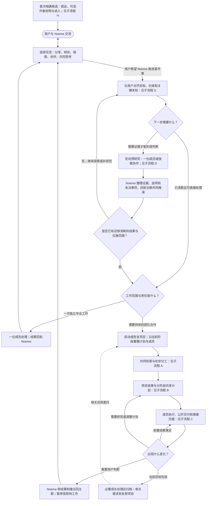

### 这张图不表达什么

它不表示所有请求都会委托，也不表示多 agent 是 Noema 的整体价值主张。Noema 可以自己完成一般对话和普通思考；把某事交给一人还是组队，取决于这次结果是否确实需要一个或多个独立专业贡献。成员数量本身不是成功标准。研究不是每个想法的默认流程：只有证据会实质改善用户与 Noema 的判断时，才有必要委托研究。

它也不表示项目会无条件持续自动运行。需要用户判断时，Noema 应把具体问题带回主聊并暂停相应项目；普通的后续交流不应被误当作批准。项目结束后的成长、归档和恢复有长期设计边界，但自动成长与完整生命周期仍未全部交付。

主聊在涉及数值结论的请求中可按需调用本地确定性算术工具，再由 Noema 结合对话给出答复；普通交流不发送计算工具定义。工具只核验表达式，不能证明输入数字、来源或假设正确。它以 50 位有效数字配置十进制运算，涉及精确货币舍入时仍须明确舍入规则。

主聊工具按当前请求开放并在单次答复内有界运行；用户停止、模型失败、应用重启后的恢复方式见子流程 F。该流程说明当前可见的运行与恢复行为，不构成 Noema 长期执行任务的完整设计。

Noema 根据已有共同经历主动回访的触发时机、频率与暂停方式仍未定，因此不把它伪装成当前已存在的闭环。

## 子流程 H：第一次相遇（第二版可运行候选，待评）

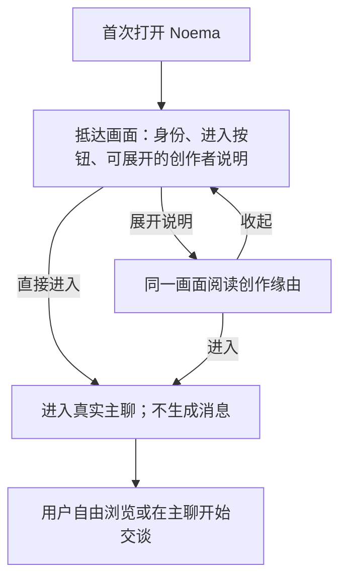

旧版强制先读信和独占首句输入页已被用户否决。当前保留专门首次体验，改为一个完整的抵达画面；作者说明可展开，进入不要求任何文字。没有问卷、预置消息或自动生成的自我介绍，也不自动聚焦输入框。阅读和进入不调用模型。已有档案不被强制重新引导，设置可重看。

本机分别记录打开作者说明和进入的事实。用户未打开说明时，模型只取得实际抵达背景，不能假定用户读过作者文字；旧版曝光仍对应旧文案，新版本不会悄悄替换历史。点击不表示认可愿景或建立亲密关系。首次体验的取向与美感仍需用户评审，不能以运行成功视为通过。

## 子流程 D：从交流到研究，再到实施（设计方向待评）

用户与 Noema 的交流可能只是分享、倾诉或探索。若用户确实希望推进某事，Noema 先澄清结果、约束和影响判断的未知；只有当外部证据能帮助作出选择时，才提议或启动定向研究。研究范围要回答一个具体问题，产物是可追溯的证据与选择，不是把模糊想法过早扩写成完整规格。Noema 将研究发现带回主聊，与用户继续推演；决定尚不成熟时可以追加小范围研究或调整方向，不自动进入实施。

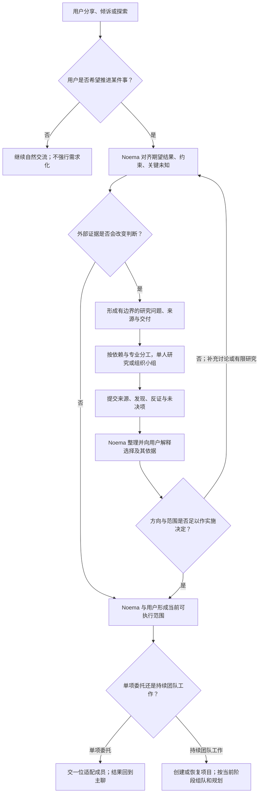

该方向来自用户对个人 agent 的明确期待：Noema 既能自然交流，也能在真正需要时替用户组织研究和实施；研究发现应进入 Noema 与用户之间的思考，而不是直接由团队把模糊想法当作已批准的项目。范围裁决、研究是否值得、研究与实施是否沿用同一项目，以及用户何时必须参与，仍需通过具体场景完善。不能把本图理解为固定的两阶段工作流、自动调研承诺或已实现功能。当前运行证据仍只覆盖普通交流不自动建组、显式委托时的组队和执行；尚未实现完整的“研究—共同推演—实施”闭环。

阶段转换提案（助手建议，待评）：单人短研究继续使用单人委托；若研究需要多角色与依赖，就以“研究阶段”建立项目计划。若研究后仍推进同一用户结果，沿用该项目，版本化调整阶段计划和成员；只有目标或授权范围实质分叉时才另建项目，并只引用继续工作必需的研究来源。Noema 对用户负责的是解释证据、选择和关键未知；仅当价值方向或重大取舍无法从已知信息判断时才暂停请求用户，普通执行细节由团队按共享计划推进。项目评审只能在待处理成员报告汇总后发起，避免项目暂停后留下未送达 Noema 的交付。

## 子流程 A：共同启动与消息（#120 已接入，整体体验待评）

项目启动应提供共同目标、已知事实、约束、尚未决定的问题、当前阶段交付与成员初步职责。启动公告对成员共同可见；新成员取得最新项目资料。无需全员轮流生成确认语。一个群不按“项目群 / 讨论群”分类；需要共同讨论时，它是同一群内可选的互动行为。

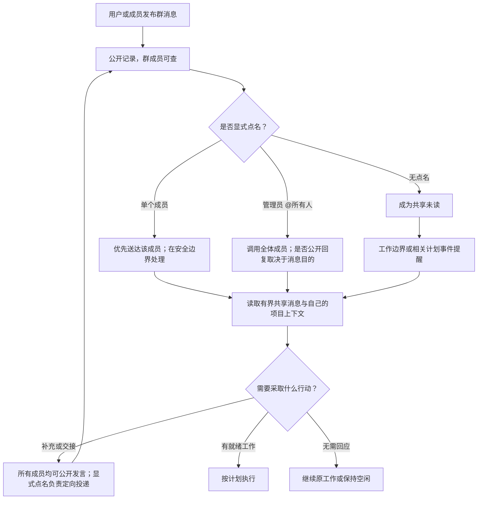

`@所有人`表达接收/调用范围，不表达“开始讨论”。它可用于通报已完成事项、计划变更或其他需要全员获知的消息；某些系统生命周期事件（如项目结束后的成长处理）也可调用相关成员，但不因此要求群内展开讨论。共同讨论是群内可选的互动模式，而非另一种群或固定项目流程。讨论模式的具体投递、合并、结束与成本边界属于工程设计，应从成熟协作/agent 实现中校准；不在提示词中编排固定轮次或要求每个模型发言。

当前实现：建组先公开共同背景与初步职责，不等待每位成员轮流回答；群聊没有固定轮值回答者。所有成员都有公开发言权，显式 @ 用于把消息定向送达相关成员，不是获得发言权的条件。用户与成员通过同一公开发布机制交流；单人或多个显式点名都进入持久投递，用户/Noema 可 @所有人。没有点名的消息只进入共享记录，成员在下一工作边界合并收到未读提醒，可以补充、交接或保持安静。普通回复不自动报告 Noema。

他人的公开发言按来源资料注入，不能伪装成当前成员自己的助手历史。当前到达事件单独放在输入末尾，系统提醒不会因为历史只筛选普通消息而消失。成员主动发表完整公开消息后，结尾工作说明只保留在其项目会话，避免群中重复一份成果。

当前同一项目的文字生成仍采用有界串行队列；这不要求轮流发言。跨项目、成员的其他独立工作与 Noema 主聊可分别运行。被点名的忙碌成员在安全边界收件，不强杀执行中的工具。每条公开消息只保存一份，接收与实际调用分别留记录。

## 子流程 B：共享计划（#119 当前模块）

本子流程分开回答两个问题：计划如何从用户的委托中形成，以及计划建立后如何执行与修订。前者是目标逻辑，尚未完整落地；后者的阶段化模型是 #119 当前实现，仍待基于成熟计划系统的实际模型重新评估。两者不可混作“当前系统已经具备的完整流程”。

### B1：计划如何形成（目标逻辑，待实现与评审）

不是每次对话都要形成计划。Noema 先判断用户是否在委托一件需要持续推进的工作；分享、倾诉和开放讨论继续留在对话中。形成委托后，Noema 与用户先澄清足以决定工作方向的结果、约束和关键未知，再决定由自己处理、单个成员处理，还是建立团队。若方案依赖尚未解决的外部事实或专业判断，可先安排有边界的预研究；研究结果用于修订问题理解与计划，不预设一定进入实施。只有涉及用户价值取舍、产品/审美判断或授权边界时才回到用户裁决，普通专业与工程选择由 Noema 和团队依据证据处理。

计划构建时，先保留已确认目标、约束、来源和未决假设；再把需要完成的结果拆成有责任人的工作包，标出必需输入、预期产物、验收依据以及真实的阻塞关系。仅在能帮助理解进展时使用里程碑归组；分组本身不自动成为执行依赖。先细化近期可执行工作，远期保留可调整的结果，不编造不可信的工作量或日期。提交计划前检查：每个近期工作包是否可执行、负责人是否明确、依赖是否是真正阻塞、成果如何核验、未知由谁处理。通过后形成一个有来源和版本的团队基线，再按实际依赖分派就绪工作。

计划本身不是“三列任务清单”，而应是供 agent 读写的有来源工作图。以下是待实现的结构候选，不代表当前 SQLite schema：

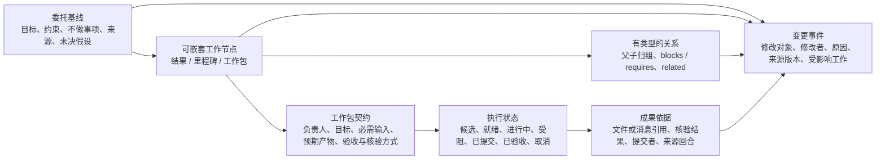

这里要防止当前实现中的语义混淆：里程碑只负责归组与结果回看；它不天然挡住后续工作。只有工作包之间明确的 `blocks/requires` 关系才决定就绪。`related` 仅提供背景，不形成硬依赖。节点可以继续拆成子节点；只有可由一个明确负责人推进、且产物可核验的叶节点才进入执行。成员提交时由运行时记录提交者；Noema 汇总时应以该身份核验交付，不从转述消息推断作者。用户评审必须等该项目的待处理成员报告全部送达后再发起。模型收到的是当前叶节点契约及必要的上游证据，按需查询整张图；每次更新针对具体节点或关系，保存来源和影响，不要求模型反复提交整张计划。

真实任务推演（本轮正在处理的 Noema 计划能力，而非展示用虚构项目）：目标是让 agent 能为 Noema 的真实跨模块开发形成并持续修订可执行计划。对应的工作包关系如下；它们指向 #119 中真实待交付的代码和验证，不是客户端演示数据：

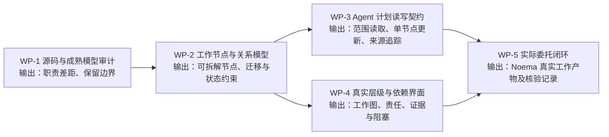

| 工作包                  | 可核验的完成条件                                                                                                                                            | 当前关系                                                                |
| ----------------------- | ----------------------------------------------------------------------------------------------------------------------------------------------------------- | ----------------------------------------------------------------------- |
| WP-1 源码与成熟模型审计 | 对照 Noema 现有 store/tool，再核对 OpenProject 的工作包类型、父子层级、typed relations、Journal/MCP 读取边界及 Linear 里程碑/范围进展；留下取舍而非功能抄单 | 已开始；现有代码已确认整计划快照写入、固定三层结构和 agent 读取整张计划 |
| WP-2 工作节点与关系模型 | 深层分解可表示；归组不自动阻塞；只有明确阻塞关系改变 readiness；兼容旧数据且历史仍可追溯                                                                    | 依赖 WP-1                                                               |
| WP-3 Agent 计划读写契约 | Agent 收到自己可执行工作包与必需上游材料；可按需读取；完成结果引用真实产物；并发局部更新不会要求重提整张图                                                  | 依赖 WP-2                                                               |
| WP-4 真实层级与依赖界面 | 客户端可理解实际父子层级、真实阻塞、负责人和产物依据；不能把里程碑数量误作项目整体完成百分比                                                                | 依赖 WP-2，可与 WP-3 并行                                               |
| WP-5 实际委托闭环       | 用“重做 Noema 计划管理”这项真实请求，由模型产出工作图、按依赖执行真实代码改动、提交文件/检查证据；加入新事实后只重开受影响工作包，核验其余成果保留          | 依赖 WP-3 与 WP-4                                                       |

当前 Noema 还不能运行 WP-2 至 WP-5；它们是该真实需求的计划结构和验收条件，不是假称已经由产品跑通。上一个三阶段 Electron fixture 只用于验证布局、权限和状态约束，不能拿来证明计划质量或团队执行能力。

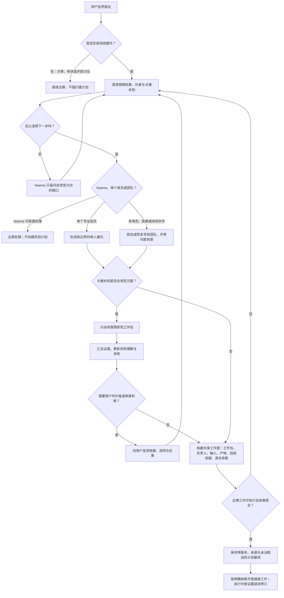

图中目标逻辑与当前实现的差距：当前组队工具会在建组时同时要求初始成员任务；共享计划工具允许模型再提交计划。系统尚未提供独立的澄清/预研究阶段、可执行性检查或上述“工作包基线”契约。因此该图表达期望的计划形成机制，不能当作已运行行为。

### B2：计划如何执行与验收（#119 当前实现）

现有实现采用“项目结果 → 阶段 → 可嵌套结构分组 → 叶工作包”，以阶段验收和阻塞依赖控制接续。分组仅用于归类并汇总后代叶工作包进度，不可领取或验收；只有叶工作包进入执行并计入工作项进度。叶工作包之间可标记对称的 `relatedTo` 关系供团队补充背景；它不改变就绪、派发或进度。计划仍以整份版本快照保存，工作包可局部修改并按字段追溯；不要求模型重交整份计划。来源目前可追到操作者、回合、修改原因和版本，尚未构成文件/消息/执行证据的完整结构化引用。

Agent 读取现支持总览、单阶段和单工作项范围；阶段范围附带阶段前置条件及其工作项依赖，工作项范围用于核对具体交付。范围读取不会改变计划版本；修改以 `expected_revision` 声明读取基础。整份替换及阶段验收严格检查全局版本，工作包局部修改只在相关范围未变时接续最新版本，见 B3。模型可按需读取精简历史，指定版本和节点才取得详细前后值。

2026-10-28 的隔离实测：将实际 Noema 项目数据库复制到临时库后，DeepSeek 在 5 次请求内生成并回读了 2 阶段、4 工作项计划；负责人均来自项目活跃成员，阶段二及其工作项依赖阶段一，阶段一两项可并行。计划读取现在同时返回有效成员名单，写入参数的负责人字段受该名单约束。该实测证明了模型与计划工具契约可协作，不代表生产客户端已完成验收；生产计划仍为 revision 0。实测还观察到计划写入会立即派发就绪工作项，第一项进入 `in_progress`，第二项进入等待/待领取状态；这是现有行为，需在实际任务中确认它是否符合用户对“只建立计划”的预期。

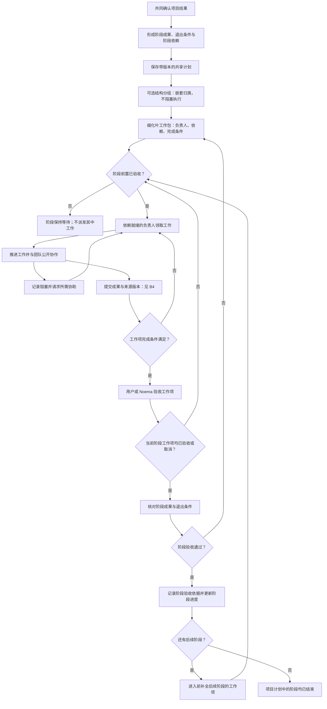

已实现（#119）：项目页与模型工具共用 SQLite 版本计划；阶段内可嵌套结构分组，只有叶工作包可执行，分组按叶工作包汇总进度且不重复计入；工作包支持阻塞依赖与对称的非阻塞相关关系。成员只更新自己负责工作包的状态和成果，用户或 Noema 验收工作包及阶段。未验收前置阶段不会派发后续工作；阶段验收需要全部有效叶工作包完成并提交阶段依据。父子循环、依赖循环、跨阶段遗漏依赖、关系目标缺失和旧版本覆盖被拒绝，旧扁平计划会保留为一个兼容阶段。进度以阶段验收数汇总，同时提供叶工作包验收率；提交不计完成，取消项不计比例。计划写入、范围读取、层级汇总、验收和依赖解锁有定向测试；真实客户端隔离预览通过，用户评审和真实委托闭环仍未完成。

团队交流、公开求助和依赖接续已在 #120 接入；计划质量和端到端产品体验仍需 #118 评审。实际领取就绪工作时由运行时标记进行中，成员通过显式工具提交成果，不从自然语言“完成了”推断提交或验收。

### B3：工作包局部修订与历史回看（#119 工程实现，实际委托待验收）

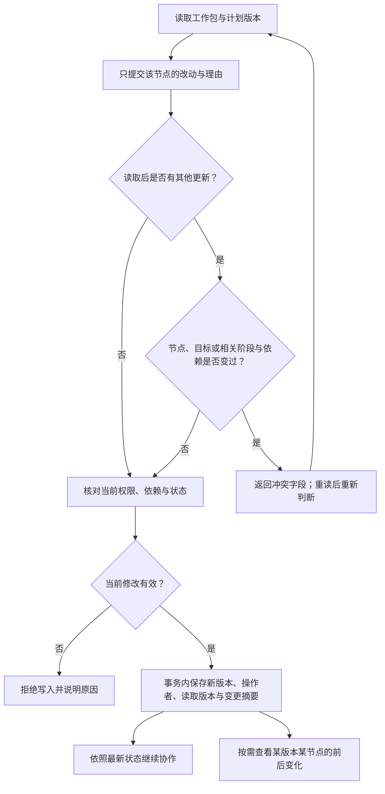

只有无关节点发生变化时才允许局部接续。相关内容改过又改回也会触发冲突，不能把当前值相同当成从未改动。关联关系的双向变化一并保留在历史中；既有无变更摘要的快照仍可回看。上述检查证明写入与追溯契约，不证明模型提出的计划及修订合理。

### B4：成果来源与重核（#119 工程实现，真实委托待验收）

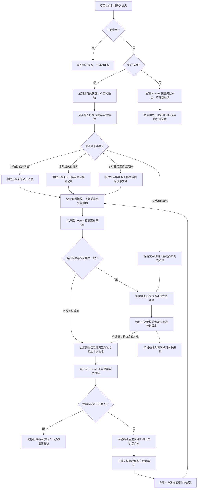

消息、执行结果与文件引用复用现有数据；来源内容仅按需返回有界摘录，不自动进入每轮上下文。指纹一致只证明版本一致，不证明成果正确；执行失败也可作为诊断依据，但仍明确保留失败状态。文件引用不得扩张任务工作区，私聊或其他项目消息不得通过引用转入公共计划。旧文字记录继续可读，不伪装成有来源的核验。没有文件监控后台，不自动唤醒模型，也不追溯改写已验收历史；检查时显示受影响的工作项，后续由实际核验者判断如何重开和修订。来源丢失时保留原指纹与元数据，不能假称仍能恢复原始内容。

## 子流程 C：公开交付与接续（#120 已运行；R0 价值待评）

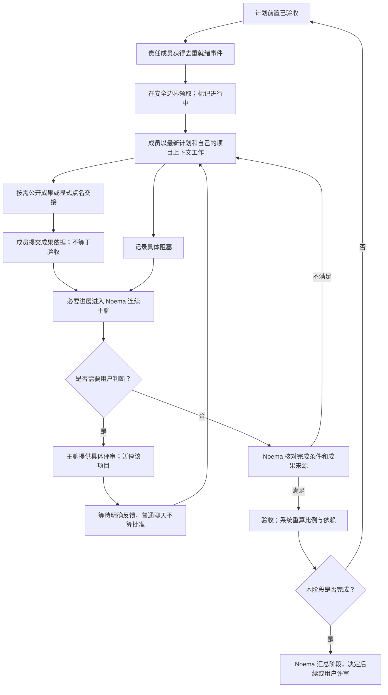

成员结束本轮但仍没有提交或记录阻塞时，系统只补交提醒一次；仍不一致便通知 Noema 协调，不无限自我催促，也不擅自将聊天文字判为完成。模型同轮给出多个项目工具调用时顺序校验、逐项反馈，保留已成功的发表与写入；版本冲突重读，不覆盖。

自动链路目前最多 24 次事件投递、深度 8，每轮最多 6 次工具续接、每批最多 4 个项目操作。普通未读在工作边界合并；失败/中断不自动重试。达到调用上限公开说明，已有成果保留，等待明确继续。以上是当前可调运行边界，不是长期产品收费承诺。

本轮真实运行证据：预先建立两位专业成员及有依赖的计划，使用 DeepSeek 完成课程方案→Noema 验收→预算核算→Noema 验收，阶段 2/2，19 次模型请求；账户人民币显示余额由 113.55 到 113.50（显示精度 0.01 元）。阶段最终进入等待用户判断，保留未计成本等真实未知。此验证刻意隔离团队协作模块，**没有证明自然输入时何时组队、计划质量或整体个人 agent 体验已经成熟**。入口：`npm run e2e:project-collaboration --prefix apps/desktop -- --live`。

## R0 摄影工作坊：旧实现的运行证据（历史对照，不代表当前行为）

补充自然使用走查（2026-10-27）：另从空白主聊用三轮自然输入走过“分享念头→补充休息与预算约束→明确研究委托”，输入不含组队或工具要求。三轮均未创建项目，普通交流没有被启动成工作；但明确委托仍由 Noema 直接生成方案，并出现过将四人结余 80 元写成亏损、人数门槛前后不一致等内容问题。当前仅形成可评审成果，**R0 整体使用价值未验收**；上面的预置团队依赖场景不能替代这一判断。真实记录保留在客户端，运行入口仍为 `npm run e2e:r0-first-use --prefix apps/desktop -- --keep-open`。

1. 用户在 Noema 主聊描述副业想法、受众、半天课程、现有场地和 3000 元预算，并要求评估需求、课程、运营和预算。
2. Noema 的模型上下文包含一段明确的协作指导，以及 `create_project_team` 能力。指导要求：普通交流由 Noema 自己处理；只有一个确实需要至少两种专业角色的复杂项目才组队；优先复用合适成员，缺位时可创建长期可拓展的成员。
3. **组队与否由模型在本轮判断。** 目前没有先运行一个独立的复杂度分类器，也没有规则引擎按关键词或任务标签自动建群。提示词和工具说明是强约束与明显引导；应用端随后验证项目成员数、身份、任务和权限等结构条件，但不独立判断“这件事是否值得组队”。
4. 本次是新用户式场景，没有适配的现有成员。模型提出了四个角色，工具以一个 2–6 人的团队请求创建项目、成员资料和每个人的首项任务。应用负责持久化并为每位成员建立该项目专属的工作会话。
5. Noema 逐个成员发出首轮任务；当前实现是**按顺序发送并等待**，不是同时广播后并行回答。每条交办以显式 `@成员名` 写入项目群；组队分工转换为群消息后，接收者由正文中的 `@` 解析，群消息发送接口不另传接收成员 ID。用户群消息与 Noema 交办共用相同的点名解析规则。因此成员任务与回复对群成员公开；每次实际生成只交给当前被点名的成员。后续成员能在自己的项目上下文中读到此前共享的群消息，但没有因“群里出现一条消息”就自动全部运行模型。
6. 成员回复既保存在项目群，也作为本轮交办结果返回给 Noema。Noema 收齐各项状态和报告后，再生成自己的综合答复，回到用户最初的主聊。用户可以在主聊继续交流；项目群仍可单独打开查看细节。

这次成功运行使用 DeepSeek `deepseek-flash`：一轮 Noema 组队判断、四位成员各自一轮、再由 Noema 汇总，共 6 次模型调用。此前一次同场景运行遇到无效工具参数而未建组；重跑成功。这说明路径已能真实运行，也说明组队判断和工具调用质量仍依赖模型输出，不能把“系统有验证”误说成“系统确定会成功”。

## 群聊消息的当前规则

| 事件                                | 可见范围                       | 模型执行                                            |
| ----------------------------------- | ------------------------------ | --------------------------------------------------- |
| 未点名的公开消息                    | 全体成员                       | 不立即调用模型；在后续工作边界合并为未读            |
| 显式 @一个或多个成员                | 全体成员                       | 对点名成员持久投递；在其安全边界处理                |
| 用户或 Noema @所有人                | 全体成员                       | 投递给其余成员；允许不公开回应                      |
| 成员通过工具主动发群消息            | 全体成员                       | 按正文点名规则继续投递；没有隐藏接收者参数          |
| 普通回复、工具执行细节              | 群回复可见；私有工作仍私有     | 不逐条唤醒 Noema                                    |
| 显式 @Noema、提交/阻塞/阶段验收事件 | 群记录保留来源；Noema 主聊反馈 | 合并到 Noema 自己的连续会话处理，不开一个额外协调者 |

群聊不是完整上下文窗口：成员的项目上下文、常驻会话和其他项目仍分离。共享消息带身份与来源，不复制所有人的私有工作记录。成员接受邀请后再加入的社交确认环节尚未实现，不应误认为已经存在。

## 已实现与仍需验证的边界

- 共享计划、公开点名、共同背景、成员直接交接、未读合并、依赖接续与必要用户评审已在本轮接入；旧 R0 顺序咨询记录只作历史对照。
- 状态、隔离、来源归属、并发版本、停止、去重、服务重建和有界费用有针对性检查；真实知识工作依赖链已运行。部署级故障恢复、多种复杂项目与日常长期使用还不能据此一并视为通过。
- 建组与研究何时发生仍由模型根据用户交流与工具指导判断，没有宣称已经有可靠的复杂度分类器。Noema 不应把分享或漫谈默认当作项目线索。
- 执行文件工具、外部真实行动、成长沉淀、自动归档及恢复后的低成本维护，要在各自模块继续验证。当前能力不代表 AI 个体或意识已经形成。
- 用户仍保有 R0 使用价值、计划呈现和审美的验收；本次明确的工程进展不替代该验收。

## 子流程 E：按需发现网页来源（#112）

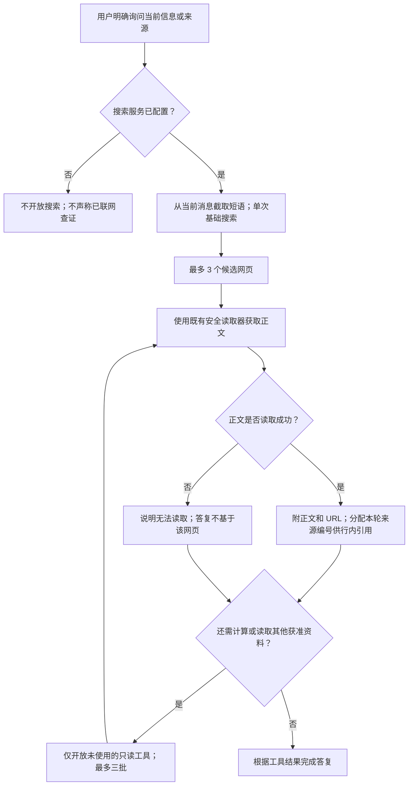

搜索服务只收到当前用户消息中的搜索短语；候选搜索结果不留存。只有安全读取器成功取回的网页正文快照会随答复保存，并获得本轮来源编号，回答中的引用标记由该编号映射至确切 URL。若计算输入数字来自网页正文，模型必须附连续原文摘录；客户端只在摘录与保存正文完全匹配时把它渲染成带摘录提示的链接。它证明页面含有该文字，不证明文字语义上支持结论。最多三批只读工具续接，最多一次基础搜索、三个正文来源；每个用户链接和计算器每轮至多使用一次。后台委派、互动调整等有副作用的操作不与只读工具自动续接；工具预算用尽后仅请求最终答复。用户停止回复时，取消当前搜索/读取请求且不启动下一工具批次。服务额度或速率限制时显示失败，不自动重试。配置搜索服务意味着用户同意向该服务发送搜索词；它不意味着允许上传完整聊天历史。细节与提供方替换条件见 [ADR 0037](../decisions/0037-web-search-discovery.md)。

## 子流程 F：主聊工具的停止、失败与重试（当前实现）

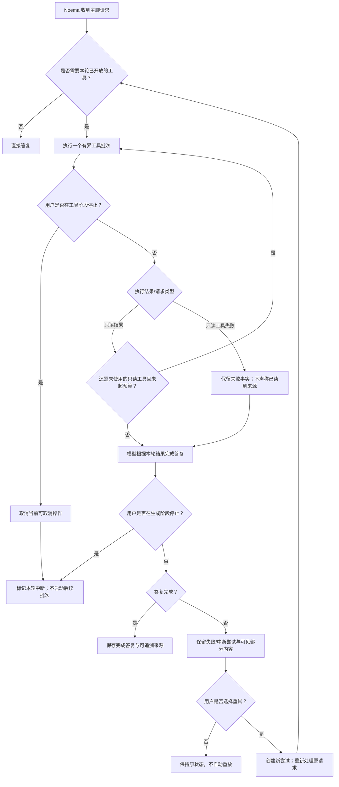

当前实现中，只读工具可以在预算内续接；含副作用的交办或互动调整不自动串入后续工具批次。用户重试会创建新的模型尝试并重新处理原请求，所以之前执行过的只读工具可能再次运行；如果再次调用按次计额的搜索服务，可能再消耗一次额度。已读取的网页来源保留在失败尝试中供查看，但不会自动复制到新尝试。若原回合已有后台任务，重试会报告已有任务而不重复启动；用户显式续接仍沿用原 DSH 会话和检查点。若互动调整已保存，重试不会自动撤回。应用重启会将尚未完成的主聊回复标为可恢复中断，不在启动时自动重新调用模型。明确的后台 DSH 任务有独立的检查点、验证与恢复规则，见 [ADR 0032](../decisions/0032-durable-project-execution-checkpoints.md)；此子流程不替代该任务生命周期。

## 子流程 G：项目经历如何进入成员成长（服务与客户端闭环已实现）

Noema 只会在主聊收到 `complete_project` 请求后，且项目共享计划至少有一项已验收交付、所有未取消事项均已验收、没有待用户评审或仍在运行的项目工作时，创建当前计划修订对应的幂等批次。成员按批次逐个在各自项目会话中复核，决定是否调整身份、原则、记忆或技能；一次经历可以不产生资产变化。Noema 不替成员写成长内容。项目页显示成员复盘进度；全部成员完成后项目自动归档，失败成员可从项目页安全重试。归档保留群聊、计划、资产与成员项目会话。

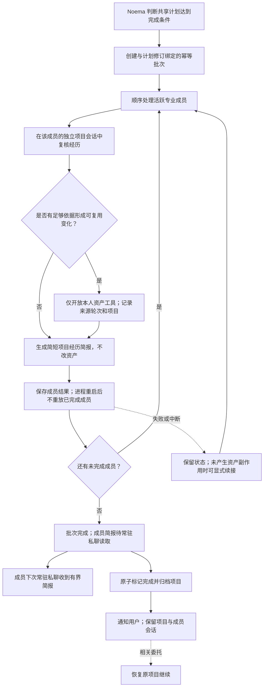

共享计划至少要有一项已验收交付；全取消项目不会触发成长。模型不可用时，批次留待应用恢复连接后继续。成员资产修改后若该轮未能保存简报，系统不会盲目重跑该轮，避免重复写入；须先核对其资产修订。常规无故障路径为每位成员一次自审推理，若成员选择修改资产，还会有一次工具结果说明推理。项目页可查看复盘进度、成员状态和安全重试入口；完成归档与状态写入可在应用重启后幂等续接。定向服务/存储测试覆盖机制边界，仍未用真实模型完成成长判断质量和桌面长期体验验收。小型后续修订不自动触发全员成长。成员成长批次的持久化与资产写入由 [ADR 0038](../decisions/0038-member-growth-batches.md) 约束。

## 依据与维护规则

- 用户提出的整体产品方向与未定边界：[产品章程](../PRODUCT_CHARTER.md)。
- 唯一 Noema 主聊、成员私聊/项目会话和项目生命周期边界：[ADR 0029](../decisions/0029-persistent-agents-and-project-sessions.md)。
- 单人有界委托的判断与成本边界：[ADR 0027](../decisions/0027-bounded-specialist-delegation.md)。
- R0 使用情境、真实验证范围与当前差距：[GitHub Issue #118](https://github.com/c3115644151/noema-agent/issues/118)。
- 当前群聊默认回应者、`@` 路由和组队工具规则可在 `apps/desktop/src/group-mentions.mjs`、`apps/desktop/src/social-chat-service.mjs` 中核对；这些代码是当前行为证据，不是永久产品规格。

参照 [ADR 0035](../decisions/0035-shared-project-plan.md)。本图是 Noema 产品逻辑的单一总览入口。发生用户方向、运行证据或长期取舍变化时，在这里改图和状态标记；不要另建并行的流程图副本。模块的接口和工程细节留在架构文档与 ADR。
