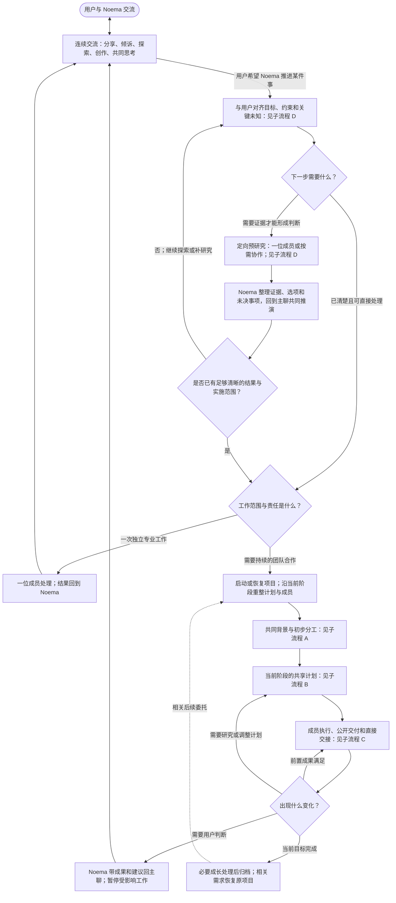
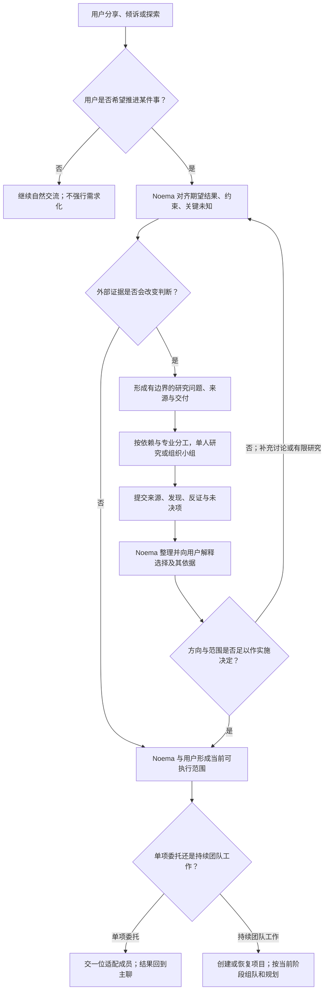
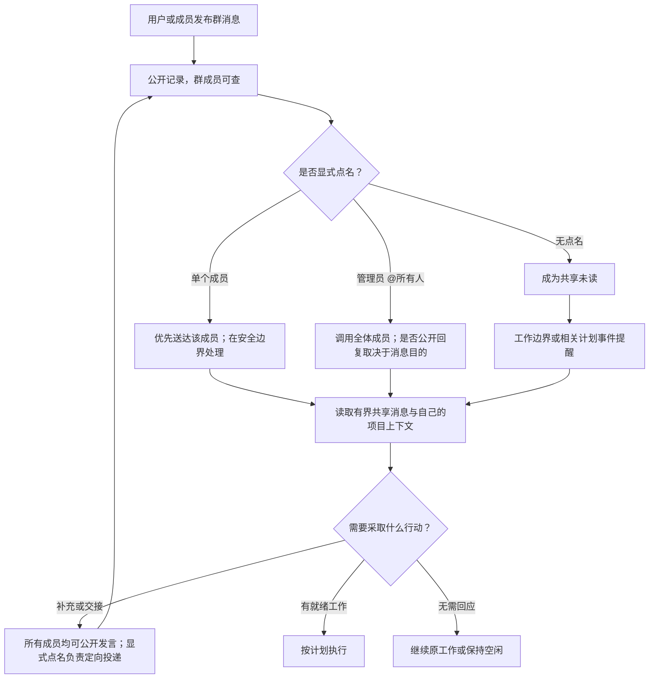
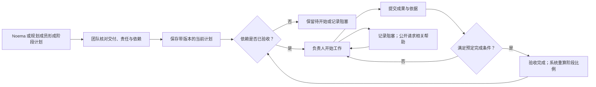
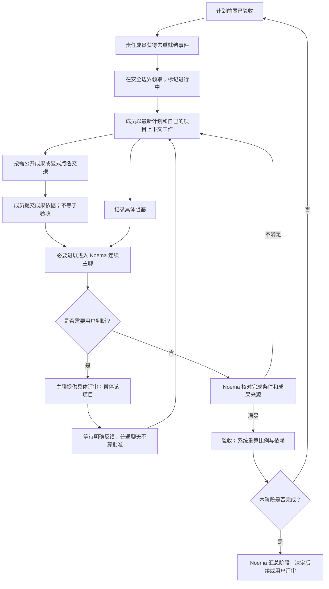
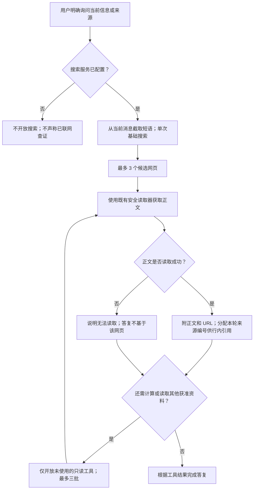

# Noema 整体核心流程图

状态：v0.7，2026-10-27 更新。近期讨论进一步区分自然交流、需求澄清、定向预研究与正式实施；这条过渡链仍是待评设计方向，并非已实现行为。补入一条助手提出的项目续接规则：同一用户结果默认沿用项目，只有目标实质分叉才另建项目。群聊保持一种共享空间；共同讨论是群内可选行为，@所有人表示调用范围，不等同于讨论意图。具体投递节奏与调用边界仍需按成熟实现校准，不在流程图里规定模型如何讨论。共享计划和群内协作已有可运行切片，但团队自主协作和整体使用价值尚未验收。增加按需来源发现子流程 E：搜索候选不等于核验，只有实际读到的网页正文可附在答复上。本文描述用户、Noema 和协作成员之间发生什么，不描述服务、数据库或模块如何实现。产品用途和品牌仍未定稿。

## 阅读标记

- **当前已运行**：本机 R0 桌面流程或现有代码能做到；不代表已通过用户验收。
- **方向已确认，交付未齐**：用户已明确过的产品边界，但当前实现仍不完整。
- **待评/待定**：图中用于呈现待讨论的设计问题，不应被视为承诺。

主流程的入口始终是用户和 Noema 的连续对话。聊天、行动、委托和协作是 Noema 根据请求选择的不同路径，不要求用户先选“聊天”或“工作”模式。

自然交流不默认被转成需求澄清。只有用户表达出希望 Noema 帮忙推进一件事时，才进入委托路径；在正式实施前，Noema 可能需要与用户澄清目标，或先做范围明确的预研究。何时预研究、怎样从研究转入实施，当前属于待评设计，见子流程 D。

当用户提出当前事实或明确要求找来源时，Noema 仅在搜索服务已配置后发现候选网页；搜索命中不等于证据核验，细节见子流程 E。

## 一张图看 Noema

### 这张图不表达什么

它不表示所有请求都会委托，也不表示多 agent 是 Noema 的整体价值主张。Noema 可以自己完成一般对话和普通思考；把某事交给一人还是组队，取决于这次结果是否确实需要一个或多个独立专业贡献。成员数量本身不是成功标准。研究不是每个想法的默认流程：只有证据会实质改善用户与 Noema 的判断时，才有必要委托研究。

它也不表示项目会无条件持续自动运行。需要用户判断时，Noema 应把具体问题带回主聊并暂停相应项目；普通的后续交流不应被误当作批准。项目结束后的成长、归档和恢复有长期设计边界，但自动成长与完整生命周期仍未全部交付。

主聊在涉及数值结论的请求中可按需调用本地确定性算术工具，再由 Noema 结合对话给出答复；普通交流不发送计算工具定义。工具只核验表达式，不能证明输入数字、来源或假设正确。它以 50 位有效数字配置十进制运算，涉及精确货币舍入时仍须明确舍入规则。

Noema 根据已有共同经历主动回访的触发时机、频率与暂停方式仍未定，因此不把它伪装成当前已存在的闭环。

## 子流程 D：从交流到研究，再到实施（设计方向待评）

用户与 Noema 的交流可能只是分享、倾诉或探索。若用户确实希望推进某事，Noema 先澄清结果、约束和影响判断的未知；只有当外部证据能帮助作出选择时，才提议或启动定向研究。研究范围要回答一个具体问题，产物是可追溯的证据与选择，不是把模糊想法过早扩写成完整规格。Noema 将研究发现带回主聊，与用户继续推演；决定尚不成熟时可以追加小范围研究或调整方向，不自动进入实施。

该方向来自用户对个人 agent 的明确期待：Noema 既能自然交流，也能在真正需要时替用户组织研究和实施；研究发现应进入 Noema 与用户之间的思考，而不是直接由团队把模糊想法当作已批准的项目。范围裁决、研究是否值得、研究与实施是否沿用同一项目，以及用户何时必须参与，仍需通过具体场景完善。不能把本图理解为固定的两阶段工作流、自动调研承诺或已实现功能。当前运行证据仍只覆盖普通交流不自动建组、显式委托时的组队和执行；尚未实现完整的“研究—共同推演—实施”闭环。

阶段转换提案（助手建议，待评）：单人短研究继续使用单人委托；若研究需要多角色与依赖，就以“研究阶段”建立项目计划。若研究后仍推进同一用户结果，沿用该项目，版本化调整阶段计划和成员；只有目标或授权范围实质分叉时才另建项目，并只引用继续工作必需的研究来源。Noema 对用户负责的是解释证据、选择和关键未知；仅当价值方向或重大取舍无法从已知信息判断时才暂停请求用户，普通执行细节由团队按共享计划推进。

## 子流程 A：共同启动与消息（#120 已接入，整体体验待评）

项目启动应提供共同目标、已知事实、约束、尚未决定的问题、当前阶段交付与成员初步职责。启动公告对成员共同可见；新成员取得最新项目资料。无需全员轮流生成确认语。一个群不按“项目群 / 讨论群”分类；需要共同讨论时，它是同一群内可选的互动行为。

`@所有人`表达接收/调用范围，不表达“开始讨论”。它可用于通报已完成事项、计划变更或其他需要全员获知的消息；某些系统生命周期事件（如项目结束后的成长处理）也可调用相关成员，但不因此要求群内展开讨论。共同讨论是群内可选的互动模式，而非另一种群或固定项目流程。讨论模式的具体投递、合并、结束与成本边界属于工程设计，应从成熟协作/agent 实现中校准；不在提示词中编排固定轮次或要求每个模型发言。

当前实现：建组先公开共同背景与初步职责，不等待每位成员轮流回答；群聊没有固定轮值回答者。所有成员都有公开发言权，显式 @ 用于把消息定向送达相关成员，不是获得发言权的条件。用户与成员通过同一公开发布机制交流；单人或多个显式点名都进入持久投递，用户/Noema 可 @所有人。没有点名的消息只进入共享记录，成员在下一工作边界合并收到未读提醒，可以补充、交接或保持安静。普通回复不自动报告 Noema。

他人的公开发言按来源资料注入，不能伪装成当前成员自己的助手历史。当前到达事件单独放在输入末尾，系统提醒不会因为历史只筛选普通消息而消失。成员主动发表完整公开消息后，结尾工作说明只保留在其项目会话，避免群中重复一份成果。

当前同一项目的文字生成仍采用有界串行队列；这不要求轮流发言。跨项目、成员的其他独立工作与 Noema 主聊可分别运行。被点名的忙碌成员在安全边界收件，不强杀执行中的工具。每条公开消息只保存一份，接收与实际调用分别留记录。

## 子流程 B：共享计划（#119 当前模块）

采用交付物分解、滚动规划与显式工作状态。规划是团队的一项责任，不是固定角色或消息中转层；可由 Noema、成员或用户按阶段承担。目标、交付项、负责人、完成条件与依赖属于共享项目资料，不只存在于某位成员的上下文。

已实现（#119）：项目页与模型工具共用 SQLite 版本计划；成员只更新自己的执行状态和成果，用户或 Noema 验收；循环依赖、未验收前置和旧版本覆盖被拒绝，重启保留。阶段比例只计算当前未取消交付项的验收完成率，提交不计完成；空计划没有百分比。更改范围留下版本与原因。计划编辑、提交、验收、依赖解锁和冲突提示已在隔离客户端走通；视觉仍待用户评审。

团队交流、公开求助和依赖接续已在 #120 接入；计划质量和端到端产品体验仍需 #118 评审。实际领取就绪工作时由运行时标记进行中，成员通过显式工具提交成果，不从自然语言“完成了”推断提交或验收。

## 子流程 C：公开交付与接续（#120 已运行；R0 价值待评）

成员结束本轮但仍没有提交或记录阻塞时，系统只补交提醒一次；仍不一致便通知 Noema 协调，不无限自我催促，也不擅自将聊天文字判为完成。模型同轮给出多个项目工具调用时顺序校验、逐项反馈，保留已成功的发表与写入；版本冲突重读，不覆盖。

自动链路目前最多 24 次事件投递、深度 8，每轮最多 6 次工具续接、每批最多 4 个项目操作。普通未读在工作边界合并；失败/中断不自动重试。达到调用上限公开说明，已有成果保留，等待明确继续。以上是当前可调运行边界，不是长期产品收费承诺。

本轮真实运行证据：预先建立两位专业成员及有依赖的计划，使用 DeepSeek 完成课程方案→Noema 验收→预算核算→Noema 验收，阶段 2/2，19 次模型请求；账户人民币显示余额由 113.55 到 113.50（显示精度 0.01 元）。阶段最终进入等待用户判断，保留未计成本等真实未知。此验证刻意隔离团队协作模块，**没有证明自然输入时何时组队、计划质量或整体个人 agent 体验已经成熟**。入口：`npm run e2e:project-collaboration --prefix apps/desktop -- --live`。

## R0 摄影工作坊：旧实现的运行证据（历史对照，不代表当前行为）

补充自然使用走查（2026-10-27）：另从空白主聊用三轮自然输入走过“分享念头→补充休息与预算约束→明确研究委托”，输入不含组队或工具要求。三轮均未创建项目，普通交流没有被启动成工作；但明确委托仍由 Noema 直接生成方案，并出现过将四人结余 80 元写成亏损、人数门槛前后不一致等内容问题。当前仅形成可评审成果，**R0 整体使用价值未验收**；上面的预置团队依赖场景不能替代这一判断。真实记录保留在客户端，运行入口仍为 `npm run e2e:r0-first-use --prefix apps/desktop -- --keep-open`。

1. 用户在 Noema 主聊描述副业想法、受众、半天课程、现有场地和 3000 元预算，并要求评估需求、课程、运营和预算。
2. Noema 的模型上下文包含一段明确的协作指导，以及 `create_project_team` 能力。指导要求：普通交流由 Noema 自己处理；只有一个确实需要至少两种专业角色的复杂项目才组队；优先复用合适成员，缺位时可创建长期可拓展的成员。
3. **组队与否由模型在本轮判断。** 目前没有先运行一个独立的复杂度分类器，也没有规则引擎按关键词或任务标签自动建群。提示词和工具说明是强约束与明显引导；应用端随后验证项目成员数、身份、任务和权限等结构条件，但不独立判断“这件事是否值得组队”。
4. 本次是新用户式场景，没有适配的现有成员。模型提出了四个角色，工具以一个 2–6 人的团队请求创建项目、成员资料和每个人的首项任务。应用负责持久化并为每位成员建立该项目专属的工作会话。
5. Noema 逐个成员发出首轮任务；当前实现是**按顺序发送并等待**，不是同时广播后并行回答。每条交办以显式 `@成员名` 写入项目群；组队分工转换为群消息后，接收者由正文中的 `@` 解析，群消息发送接口不另传接收成员 ID。用户群消息与 Noema 交办共用相同的点名解析规则。因此成员任务与回复对群成员公开；每次实际生成只交给当前被点名的成员。后续成员能在自己的项目上下文中读到此前共享的群消息，但没有因“群里出现一条消息”就自动全部运行模型。
6. 成员回复既保存在项目群，也作为本轮交办结果返回给 Noema。Noema 收齐各项状态和报告后，再生成自己的综合答复，回到用户最初的主聊。用户可以在主聊继续交流；项目群仍可单独打开查看细节。

这次成功运行使用 DeepSeek `deepseek-flash`：一轮 Noema 组队判断、四位成员各自一轮、再由 Noema 汇总，共 6 次模型调用。此前一次同场景运行遇到无效工具参数而未建组；重跑成功。这说明路径已能真实运行，也说明组队判断和工具调用质量仍依赖模型输出，不能把“系统有验证”误说成“系统确定会成功”。

## 群聊消息的当前规则

| 事件 | 可见范围 | 模型执行 |
| --- | --- | --- |
| 未点名的公开消息 | 全体成员 | 不立即调用模型；在后续工作边界合并为未读 |
| 显式 @一个或多个成员 | 全体成员 | 对点名成员持久投递；在其安全边界处理 |
| 用户或 Noema @所有人 | 全体成员 | 投递给其余成员；允许不公开回应 |
| 成员通过工具主动发群消息 | 全体成员 | 按正文点名规则继续投递；没有隐藏接收者参数 |
| 普通回复、工具执行细节 | 群回复可见；私有工作仍私有 | 不逐条唤醒 Noema |
| 显式 @Noema、提交/阻塞/阶段验收事件 | 群记录保留来源；Noema 主聊反馈 | 合并到 Noema 自己的连续会话处理，不开一个额外协调者 |

群聊不是完整上下文窗口：成员的项目上下文、常驻会话和其他项目仍分离。共享消息带身份与来源，不复制所有人的私有工作记录。成员接受邀请后再加入的社交确认环节尚未实现，不应误认为已经存在。

## 已实现与仍需验证的边界

- 共享计划、公开点名、共同背景、成员直接交接、未读合并、依赖接续与必要用户评审已在本轮接入；旧 R0 顺序咨询记录只作历史对照。
- 状态、隔离、来源归属、并发版本、停止、去重、服务重建和有界费用有针对性检查；真实知识工作依赖链已运行。部署级故障恢复、多种复杂项目与日常长期使用还不能据此一并视为通过。
- 建组与研究何时发生仍由模型根据用户交流与工具指导判断，没有宣称已经有可靠的复杂度分类器。Noema 不应把分享或漫谈默认当作项目线索。
- 执行文件工具、外部真实行动、成长沉淀、自动归档及恢复后的低成本维护，要在各自模块继续验证。当前能力不代表 AI 个体或意识已经形成。
- 用户仍保有 R0 使用价值、计划呈现和审美的验收；本次明确的工程进展不替代该验收。

## 子流程 E：按需发现网页来源（#112）

搜索服务只收到当前用户消息中的搜索短语；候选搜索结果不留存。只有安全读取器成功取回的网页正文快照会随答复保存，并获得本轮来源编号，回答中的引用标记由该编号映射至确切 URL。模型可为影响结论的数字附加连续原文摘录；客户端只在摘录与保存正文完全匹配时把它渲染成带摘录提示的链接。它证明页面含有该文字，不证明文字语义上支持结论。最多三批只读工具续接，最多一次基础搜索、三个正文来源；每个用户链接和计算器每轮至多使用一次。后台委派、互动调整等有副作用的操作不与只读工具自动续接；工具预算用尽后仅请求最终答复。服务额度或速率限制时显示失败，不自动重试。配置搜索服务意味着用户同意向该服务发送搜索词；它不意味着允许上传完整聊天历史。细节与提供方替换条件见 [ADR 0037](../decisions/0037-web-search-discovery.md)。

## 依据与维护规则

- 用户提出的整体产品方向与未定边界：[产品章程](../PRODUCT_CHARTER.md)。
- 唯一 Noema 主聊、成员私聊/项目会话和项目生命周期边界：[ADR 0029](../decisions/0029-persistent-agents-and-project-sessions.md)。
- 单人有界委托的判断与成本边界：[ADR 0027](../decisions/0027-bounded-specialist-delegation.md)。
- R0 使用情境、真实验证范围与当前差距：[GitHub Issue #118](https://github.com/c3115644151/noema-agent/issues/118)。
- 当前群聊默认回应者、`@` 路由和组队工具规则可在 `apps/desktop/src/group-mentions.mjs`、`apps/desktop/src/social-chat-service.mjs` 中核对；这些代码是当前行为证据，不是永久产品规格。

参照 [ADR 0035](../decisions/0035-shared-project-plan.md)。本图是 Noema 产品逻辑的单一总览入口。发生用户方向、运行证据或长期取舍变化时，在这里改图和状态标记；不要另建并行的流程图副本。模块的接口和工程细节留在架构文档与 ADR。

