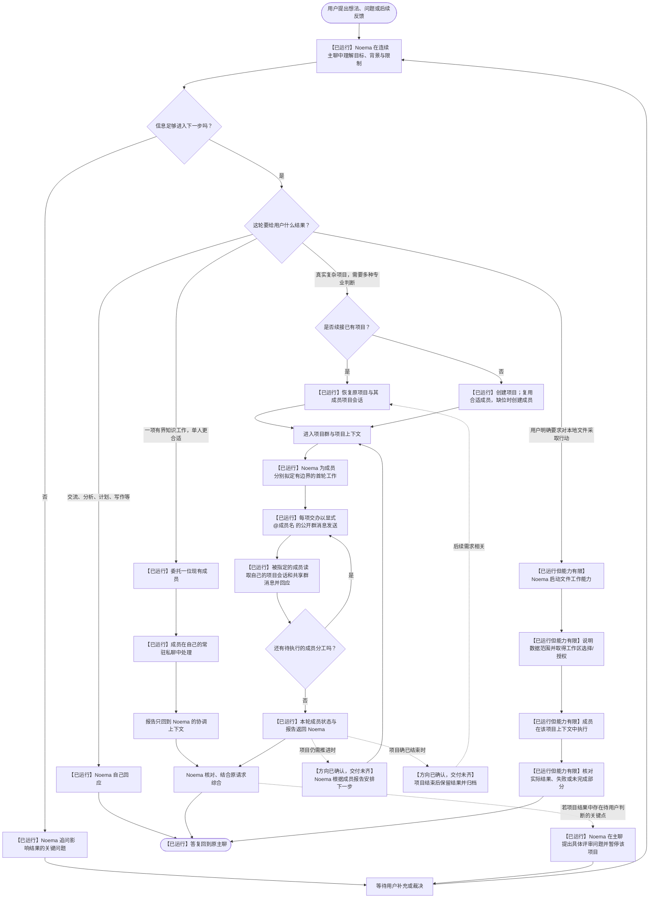

# Noema 整体核心流程图

状态：v0.1，逻辑评审稿。它描述用户、Noema 和协作成员之间发生什么，不描述服务、数据库或模块如何实现。产品用途和品牌仍未定稿；此图是当前产品边界与已运行路径的合并视图，不等于最终规格。

## 阅读标记

- **当前已运行**：本机 R0 桌面流程或现有代码能做到；不代表已通过用户验收。
- **方向已确认，交付未齐**：用户已明确过的产品边界，但当前实现仍不完整。
- **待评/待定**：图中用于呈现待讨论的设计问题，不应被视为承诺。

主流程的入口始终是用户和 Noema 的连续对话。聊天、行动、委托和协作是 Noema 根据请求选择的不同路径，不要求用户先选“聊天”或“工作”模式。

## 一张图看 Noema

### 这张图不表达什么

它不表示所有请求都会委托，也不表示多 agent 是 Noema 的整体价值主张。Noema 可以自己完成一般对话和普通思考；把某事交给一人还是组队，取决于这次结果是否确实需要一个或多个独立专业贡献。成员数量本身不是成功标准。

它也不表示项目会无条件持续自动运行。需要用户判断时，Noema 应把具体问题带回主聊并暂停相应项目；普通的后续交流不应被误当作批准。项目结束后的成长、归档和恢复有长期设计边界，但自动成长与完整生命周期仍未全部交付。

v0.1 先画用户主动发起的主流程。Noema 根据已有共同经历主动回访的触发时机、频率与暂停方式仍未定，因此不把它伪装成当前已存在的闭环。

## R0 摄影工作坊这次是怎样走过来的

1. 用户在 Noema 主聊描述副业想法、受众、半天课程、现有场地和 3000 元预算，并要求评估需求、课程、运营和预算。
2. Noema 的模型上下文包含一段明确的协作指导，以及 `create_project_team` 能力。指导要求：普通交流由 Noema 自己处理；只有一个确实需要至少两种专业角色的复杂项目才组队；优先复用合适成员，缺位时可创建长期可拓展的成员。
3. **组队与否由模型在本轮判断。** 目前没有先运行一个独立的复杂度分类器，也没有规则引擎按关键词或任务标签自动建群。提示词和工具说明是强约束与明显引导；应用端随后验证项目成员数、身份、任务和权限等结构条件，但不独立判断“这件事是否值得组队”。
4. 本次是新用户式场景，没有适配的现有成员。模型提出了四个角色，工具以一个 2–6 人的团队请求创建项目、成员资料和每个人的首项任务。应用负责持久化并为每位成员建立该项目专属的工作会话。
5. Noema 逐个成员发出首轮任务；当前实现是**按顺序发送并等待**，不是同时广播后并行回答。每条交办以显式 `@成员名` 写入项目群；组队分工转换为群消息后，接收者由正文中的 `@` 解析，群消息发送接口不另传接收成员 ID。用户群消息与 Noema 交办共用相同的点名解析规则。因此成员任务与回复对群成员公开；每次实际生成只交给当前被点名的成员。后续成员能在自己的项目上下文中读到此前共享的群消息，但没有因“群里出现一条消息”就自动全部运行模型。
6. 成员回复既保存在项目群，也作为本轮交办结果返回给 Noema。Noema 收齐各项状态和报告后，再生成自己的综合答复，回到用户最初的主聊。用户可以在主聊继续交流；项目群仍可单独打开查看细节。

这次成功运行使用 DeepSeek `deepseek-flash`：一轮 Noema 组队判断、四位成员各自一轮、再由 Noema 汇总，共 6 次模型调用。此前一次同场景运行遇到无效工具参数而未建组；重跑成功。这说明路径已能真实运行，也说明组队判断和工具调用质量仍依赖模型输出，不能把“系统有验证”误说成“系统确定会成功”。

## 群聊里一条消息对成员意味着什么

群消息的**可见范围**与**执行对象**是两回事：

| 群内事件 | 谁能看见 | 谁会在此刻生成回复 |
| --- | --- | --- |
| Noema 为某成员发布首轮项目任务 | 全体群成员 | 只由被指定的那位成员处理；当前成员分工按顺序执行 |
| 某位成员在群里回复 | 全体群成员 | 只有该成员生成了这条回复；其他成员不会自动接着发言 |
| 用户在项目群发普通消息 | 全体群成员 | 默认由 Noema 回应（如果 Noema 在群内）；其他成员不因看见消息而自动运行 |
| 用户在消息中 `@成员名` | 全体群成员 | 被点名的一位成员使用自己的该项目会话回应；其他成员只获得共享消息，不自动运行 |

当前一条群消息只允许指定一位成员；`@所有人` 尚未接入。创建团队时，Noema 直接建立/加入成员并分派首轮任务，当前代码没有“先在私聊邀请、等待成员接受，再入群”的步骤。是否需要这个社交确认环节属于待评设计，不应误以为已实现。

因此，群聊不是把同一份模型上下文复制给所有成员，也不是一个工具日志窗口。成员有各自身份和项目会话；公开群记录作为有限共享背景，具体消息再决定由谁处理。用户能在群里看到过程；Noema 只在收到阶段报告或这轮项目组工具返回时参与协调，不逐个旁听成员的每个工具动作。

## 现有运行与产品方向的差距

- **已运行的 R0 路径**：主聊中的模型判断 → 创建/恢复项目与成员 → 逐个发布公开群任务 → 成员报告 → Noema 汇总回主聊。
- **已确认但仍需完整交付的边界**：单人成员与多人项目应区分；群消息公开；`@成员名` 指定唯一回应者；项目上下文与成员常驻上下文分开；用户需要判断时回主聊并暂停对应项目。
- **尚未由这次运行证明**：Noema 收到阶段报告后自动连续续派；用户评审暂停/恢复；成员经验沉淀；项目自动归档后恢复同一成员会话；消息中断、排队与重启后的完整恢复。
- **当前群聊的范围限制**：默认由 Noema 回应；每条用户消息最多 `@` 一位成员；没有 `@所有人`；消息公开可见不会自动触发全员推理。项目启动交办的当前轮次是串行的。
- **入群身份确认未实现**：若产品仍要保留“成员先接受邀请再参加项目”的设想，需要另行明确邀请被拒绝/超时/替换时怎么走；本图不假设这个决定已经作出。
- **目前显出的决策薄弱处**：模型拥有“可以组队”的工具和提示，但应用没有独立的可解释判据来确保它何时该组、组几人、是否需要先澄清。当前模型可能一次创建四人，也可能工具调用格式出错。要不要给 Noema 增加硬规则、澄清节点或成本约束，是下一轮评审问题，不由这张图先替用户决定。

## 依据与维护规则

- 用户提出的整体产品方向与未定边界：[产品章程](../PRODUCT_CHARTER.md)。
- 唯一 Noema 主聊、成员私聊/项目会话和项目生命周期边界：[ADR 0029](../decisions/0029-persistent-agents-and-project-sessions.md)。
- 单人有界委托的判断与成本边界：[ADR 0027](../decisions/0027-bounded-specialist-delegation.md)。
- R0 使用情境、真实验证范围与当前差距：[GitHub Issue #118](https://github.com/c3115644151/noema-agent/issues/118)。
- 当前群聊默认回应者、`@` 路由和组队工具规则可在 `apps/desktop/src/group-mentions.mjs`、`apps/desktop/src/social-chat-service.mjs` 中核对；这些代码是当前行为证据，不是永久产品规格。

本图是 Noema 产品逻辑的单一总览入口。发生用户方向、运行证据或长期取舍变化时，在这里改图和状态标记；不要另建并行的流程图副本。模块的接口和工程细节留在架构文档与 ADR。
